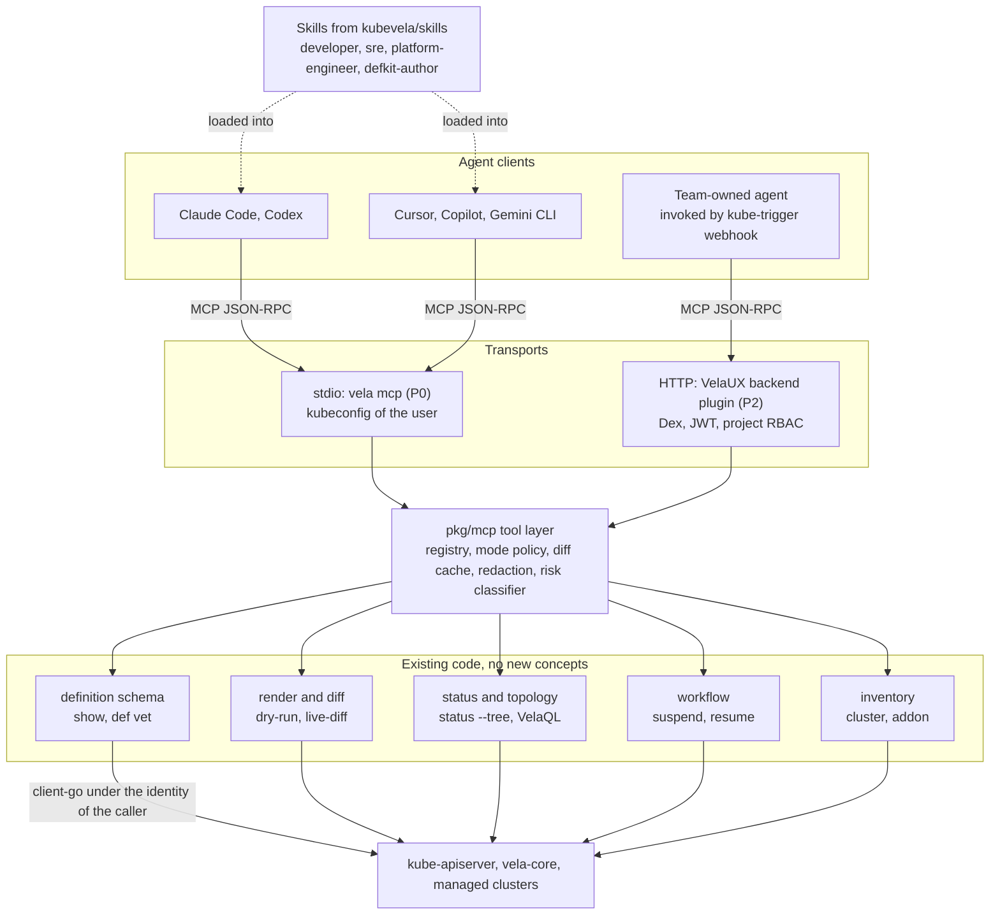
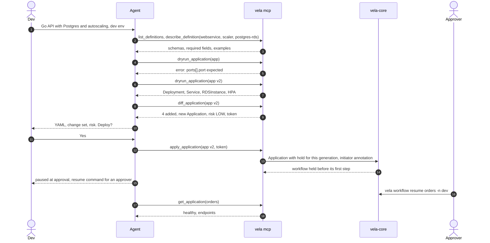

# KEP: Vela MCP - Agent-Operable Delivery, Diagnosis and Remediation

**Authors**: Anoop Gopalakrishnan
**Status**: Draft
**Created**: 2026-09-29
**Last Updated**: 2026-09-29

> **Status**: Design proposal. Tool names, schemas and flag names may change during
> implementation and community review. Nothing here is committed behaviour.

## Summary

`vela mcp` exposes KubeVela to AI agents over the Model Context Protocol from inside the
`vela` binary. It wraps code that already ships (definition schemas, dry-run, live-diff,
status tree, VelaQL views, workflow suspend and resume) as fifteen deterministic tools,
with read-only as the default and every write rendered, diffed and gated through the
Application's own workflow. Every response states the versions it ran against, when the
data was observed, and which objects each explanation was derived from. A companion repository holds skills, client setup templates
and an evaluation suite that runs across model families.

Three things make this more than a Kubernetes MCP with an OAM accent:

| Bet | What it means for the user |
|---|---|
| Render and diff before anything exists | An agent cannot apply what it has not shown as a resource-level change set with a risk class |
| Writes pause for a human, outside the spec | An agent-initiated change holds before its first workflow step until someone with resume rights confirms; the Application's declared workflow is never edited, and the agent cannot resume by default |
| Platform engineers get an authoring loop | defkit in Go, `vela def vet`, dry-run against local definitions, consumer impact before a change |

For incident work, Vela MCP is the connective piece of a reference stack with a read-only
Kubernetes MCP and the team's observability MCP. It hands them the keys (labels, pods,
windows) rather than owning telemetry.

## Motivation

- **Agents hallucinate OAM.** Component and trait parameters live in CUE schemas a model
  cannot recall at useful fidelity. Without a schema tool the agent guesses and finds out
  at apply time.
- **Discovery is KubeVela's adoption ceiling.** A new user learns Application, Definition,
  Trait, Policy and Workflow before the first deploy. An agent that discovers and composes
  interactively removes most of that ramp.
- **No agent surface exists anywhere in the ecosystem.** Across the kubevela and
  kubevela-contrib organisations there is no MCP, LLM or agent work.
- **Agent access without approval is the common failure.** Most platform MCP servers
  expose direct create, update and delete tools, so an agent change reaches the cluster
  with no preview and no gate. KubeVela already has workflow suspend, live-diff and
  dry-run. Composing them gives approval and audit without inventing anything.

### Goals

1. From "I need a service with X and Y" to a valid, rendered, diffed Application without
   the user knowing OAM vocabulary.
2. No agent write reaches a cluster without a rendered diff; none reaches production
   without a human gate or a Git handoff.
3. Explain a degraded Application from KubeVela's own dependency graph, and hand the
   observability MCP exact labels and time windows to continue.
4. A platform engineer authors, validates and renders a new capability with defkit through
   an agent in one sitting.
5. Identical authorisation across CLI, VelaUX and MCP. The agent is the user.
6. Works with every mainstream MCP client and any model. No model-provider dependency in
   KubeVela.

### Non-Goals

1. Owning or proxying log search, metrics, traces, cost or DORA data. A bounded, redacted
   log tail for a managed component is in scope because it comes from the same API server
   read as status; search, retention and correlation across time are not.
2. Wrapping raw Kubernetes CRUD, `exec` or `port-forward`.
3. A built-in LLM agent in vela-core or VelaUX.
4. Replacing YAML, VelaUX or GitOps as the primary developer interface.
5. Cluster-fleet tools before the Cluster Infrastructure KEP lands. They are in scope
   afterwards; see [Future scope](#future-scope-cluster-fleet-tools).
6. Validating definition parameters at admission. That belongs in its own proposal and
   helps humans as much as agents; this KEP consumes it when it lands, see
   [Accuracy contract](#accuracy-contract).

## Proposal

### Mental model



Every tool maps to a code path the CLI already has. Where that logic lives only inside a
cobra `RunE`, it is lifted into a plain package first (`pkg/velaops`), which also makes
those commands unit-testable. Handlers never shell out and never call a model.

### Principles

1. **KubeVela computes, the model explains.** Risk classes, diffs and root-cause ordering
   come from deterministic code.
2. **Read-only until an administrator says otherwise.** Write tools are absent from
   `tools/list` unless enabled at server start. No runtime toggle a prompt could flip.
3. **Every write is computed, then confirmed by a human.** `apply_application` requires a
   token from a `diff_application` call on the same content in the same session. The token
   binds the exact document to the base revision it was diffed against; it does not prove
   anyone read the diff. Human confirmation comes from the mode: pull-request review for
   `gitops`, the cluster-side hold for `gated`, and a server-written prompt for `direct`.
4. **The agent is the user.** Same kubeconfig, impersonation, RBAC and audit as `vela`.
5. **No new vocabulary.** Tool names use definition, application, workflow, cluster, addon.
6. **Every answer says where it came from and how fresh it is.** Status tools read live
   from the API server, never from an informer cache, and every response carries the
   objects it was derived from and the time they were observed. An explanation that cannot
   cite an object says "unknown" for that part instead of inferring it.
7. **Version-aware.** The server knows the vela-core version, the CLI version, the
   Kubernetes version of every cluster it touches and the feature gates that change
   behaviour, and it includes them in responses so the model explains the system that is
   actually running, not the one in its training data.

### Tools

| Tool | Class | Wraps | Phase |
|---|---|---|---|
| `get_platform_info` | read | `vela version`, vela-core Deployment image and flags, feature gates, Kubernetes version per cluster, enabled addons with versions, controller health | P0 |
| `list_definitions` | read | `vela def list`, `vela components`, `vela traits` | P0 |
| `describe_definition` | read | `vela show`; CUE parameters as JSON Schema, required, defaults, examples, current revision | P0 |
| `explain_definition` | read | `vela def get` + a render with defaults: what kinds it produces, which parameters drive which fields, health and status rules, restrictions, revision history, consumer count | P0 |
| `list_applications` | read | `vela ls` | P0 |
| `get_application` | read | Live Application + status; endpoints from VelaQL `endpoints` view | P0 |
| `explain_application` | read | `status --tree --detail`, VelaQL `resource-tree`, events; dependency walk; every claim cites an object | P0 |
| `get_managed_resource` | read | ResourceTracker-scoped live GET of any managed object in its cluster; refuses unmanaged objects; refuses Secret kinds before the GET and returns only metadata for them | P0 |
| `get_workflow` | read | `vela workflow` status | P0 |
| `get_logs` | read | VelaQL `component-pod` + bounded, redacted tail | P0 |
| `list_clusters` | read | `vela cluster list`; never credentials | P0 |
| `list_addons` | read | `vela addon list` | P0 |
| `dryrun_application` | plan | `vela dry-run`, including `-d` local definitions | P0 |
| `diff_application` | plan | `vela live-diff` + risk classifier; returns token | P0 |
| `apply_application` | write | `vela up` under mode policy | P0, flag |
| `find_definition_consumers` | read | Applications by component and trait type | P1 |
| `compare_definition_revisions` | read | Parameter and rendered-output diff between two DefinitionRevisions | P1 |
| `vet_definition` | plan | `vela def vet` | P1 |
| `suspend_workflow`, `terminate_workflow` | write | `vela workflow` | P1, flag |
| `resume_workflow` | write | `vela workflow resume`; separate flag; denies the recorded initiator | P1, flag |

Deliberately absent: raw Kubernetes get and patch, exec, port-forward, addon enable,
cluster join, definition apply, Secret reads.

`explain_application`, `get_application` and `get_logs` return **correlation handles**:
cluster, namespace, pod names, the label set KubeVela stamps on rendered resources,
revision and apply time, a suggested time window, and a log selector string. These are
what the observability MCP needs to continue the investigation without re-deriving names.

### Accuracy contract

The server is only worth installing if an operator can trust what it says during an
incident. Four rules make that trust checkable rather than assumed.

**Every response carries an envelope.**

```json
"meta": {
  "velaCore": "v1.11.0",
  "velaCLI": "v1.11.0",
  "clusters": {"local": {"kubernetes": "v1.31.4"}, "prod-us-west": {"kubernetes": "v1.30.8"}},
  "featureGates": {"AuthenticateApplication": false, "RestrictDefinitionNamespaces": true},
  "observedAt": "2026-10-13T09:42:17Z",
  "source": "live",
  "truncated": false
}
```

`source` is `live` for a direct API server read, `rendered` for dry-run output, and
`cached` only for definition schemas, which carry their DefinitionRevision so staleness is
visible. Status tools never serve from an informer cache. `truncated` is set whenever a
line budget or size cap cut the data, so the model knows it did not see everything.

**Every explanation cites its evidence.** `explain_application` and `explain_definition`
return an `evidence` list alongside the narrative data: for each claim, the object
reference, the field or condition it was read from, and the timestamp on that object.
A claim without evidence is not emitted. Where the server could not determine something,
for example a provider condition that was not surfaced, it lists it under `unknowns`
instead of leaving a gap the model might fill.

**Explanations are version-gated.** Behaviour that differs across releases is resolved
against the running version from the envelope, not against a fixed assumption. Examples:
how an unversioned definition reference resolves, whether `AuthenticateApplication`
applies resources as the creator, which workflow step types and policies exist. The
server ships a small table of version-dependent behaviours and consults it when building
`explain_*` output, and it says explicitly when a question cannot be answered for the
running version.

**Version mismatch is a finding.** When the CLI, vela-core, a definition's expected
controller version or a cluster's Kubernetes version fall outside their supported ranges
for each other, `get_platform_info` reports it and every other tool repeats it in the
envelope as a warning. Many production mysteries are version skew; the server should be
the first thing that notices.

**One schema for humans and agents.** `describe_definition` returns the parameter schema
the controller publishes for each definition. Today nothing rejects an undeclared or
mistyped parameter until render, so dry-run is the check the agent must pass. When
parameter validation at admission lands (separate proposal), the server serves that same
admitted schema, and an agent and a human get identical rejections for the same input
instead of the MCP being the only place the rules are applied.

The evaluation suite scores these rules directly: a fixture set of degraded Applications
with known causes where every emitted claim must resolve to a real object, a run against
two different vela-core versions where version-gated explanations must differ correctly,
and a check that no status response ever reports `source: cached`.

### Write modes

| Mode | `apply_application` does | Default for | Moves forward by |
|---|---|---|---|
| `gitops` | Returns deterministic YAML and the diff; writes nothing | Applications marked GitOps-managed, and namespaces declared GitOps | Pull-request review |
| `gated` | Applies with a one-shot hold, so the workflow does not start until confirmed | Everything else | A human with resume rights |
| `direct` | Verifies the diff token, asks the user to confirm through the client, then applies | Only namespaces on an explicit allowlist that also do not match the production pattern; a namespace matching both is refused at startup | The user, through a prompt the server writes |

**Mode is decided per Application.** Namespace policy sets the floor. An Application can
tighten its own mode with an `app.oam.dev/agent-write-mode` annotation (`gitops` or
`gated`), read from both the live object and the submitted document, and the strictest of
the three wins. A marker can only tighten, never loosen, so a value in the input cannot
weaken the policy, and a team that manages one Application through Git while the rest of
the namespace is not gets `gitops` for that Application alone. Requested mode can be
downgraded by policy (direct to gated, gated to gitops), never upgraded. A HIGH risk class
always downgrades `direct` to `gated`, so a single confirmation never approves a deletion,
a placement change or a security-surface change.

**Direct mode confirms through the client, not the agent.** After verifying the token the
server sends an MCP elicitation request, and the client shows it to the user as a native
prompt the model cannot answer:

```text
vela: apply Application shop to team-a, direct mode, no approval step
  MODIFY Deployment team-a/shop
    spec.template.spec.containers[0].image  nginx:1.26 -> nginx:1.27
  Risk LOW: image-tag
  Base revision shop-v1. Token valid for 12 more minutes.
[Apply]  [Decline]
```

The server writes this text from the same change set it hashed into the token, so a model
cannot misdescribe the change, and an agent that chains `diff_application` and
`apply_application` in one generated script, as code-execution clients do, still stops at
the prompt. Accept applies; decline writes nothing and returns "declined by user". A
client that does not support elicitation cannot use `direct`: the request is downgraded
like any other, and the response says nothing was applied because the client cannot ask
for confirmation. Some harnesses accept prompts automatically in unattended modes. That is
the user's choice, equivalent to `--yes` on the CLI; unattended automation belongs in
`gated`, where the gate lives in the cluster rather than in the client. The prompt is a
confirmation, not authorisation: RBAC still decides what may be applied.

**Gated mode does not edit the spec.** Injecting a `suspend` step would change the
Application's declared intent: it would appear in revisions and rollbacks, and a restart
would replay it. Instead the server applies the submitted Application with a hold bound
to the generation it creates:

```yaml
metadata:
  annotations:
    mcp.oam.dev/initiator: alice@example.com
    mcp.oam.dev/diff-token: sha256:...
    mcp.oam.dev/risk: LOW
    app.oam.dev/hold-generation: "4"
```

When the controller reconciles a generation that matches the hold, it starts the workflow
suspended, with a message naming the initiator, the risk class and the rules that fired,
so the approver sees what the agent saw, instead of running the first
step. `vela workflow resume` confirms it exactly as it confirms any suspended workflow, and
the controller then clears the hold. Because the hold lives outside the spec and names one
generation, revisions never contain it, a rollback is not paused by it, a restart after
confirmation does not pause again, and a later generation without a hold runs normally.
This needs a small controller change, listed under [Milestones](#milestones) as a
prerequisite for gated writes.

The server strips any `mcp.oam.dev/*` annotation and any hold present in the submitted
Application and writes its own, so neither the initiator record nor the hold can be forged
by the input.

Where the gate is enforced, and where it is not: within the MCP path the server never
exposes `resume_workflow` unless started with its flag, so an agent confined to MCP cannot
resume. An agent that also holds the user's kubeconfig and a shell can run
`vela workflow resume`, because the agent is the user and the user may resume. That is a
property of the user's RBAC, not of this server. Deployments that need the gate to hold
against shell access must restrict who may resume at the cluster, for example an
admission policy that permits the resume annotation only from an approver group, which
then applies equally to humans. The skills forbid agents from resuming and the evaluation
suite tests for it, but those are behavioural controls and the KEP does not present them
as enforcement.

The **risk class** is the maximum over rules on the live-diff output, with every fired
rule listed: image tag only is LOW; scaling is LOW; a new Application with no existing
managed resources is LOW; config and env are MEDIUM; additions to an existing Application
are MEDIUM; any deletion, replace, placement change, security-surface change, stateful
change or removed gate is HIGH, including in a new Application. The classifier is a pure
function with golden tests.

### Identity

- **stdio (P0)**: the kubeconfig user, with `--as` and `--as-group` mapped to the existing
  impersonation support in `pkg/auth`. No listener, no OAuth.
- **HTTP via VelaUX plugin (P2)**: VelaUX already proxies backend plugins under
  `/proxy/plugins/<id>/` with Dex login, JWT and project RBAC. The plugin impersonates the
  VelaUX user. The `tools/list` response is filtered per caller with
  SelfSubjectAccessReview; the API server still enforces regardless.
- **prism (option)**: an aggregated API server inherits kube-apiserver authentication for
  shops without VelaUX. Documented only if an adopter asks.

No transport introduces a privileged service identity for agents.

### Reference stack

MCP servers do not call each other; the client loads several and the model chooses. So
the pairing is a tested combination that `vela mcp setup` configures in one step, with
boundaries written into tool descriptions and skills.

| Question | Goes to |
|---|---|
| What does this Application deploy, where, in what state | Vela MCP |
| The live Deployment or Crossplane resource behind a component | Vela MCP, `get_managed_resource` |
| Nodes, quotas, an operator's own CRs, an unmanaged Ingress | Kubernetes MCP, read-only |
| Latency, error rate, traces, log search, alert history | Observability MCP (Grafana, Datadog, Prometheus) |
| Change anything an Application manages | Vela MCP, diffed and gated |
| Change anything else | Neither, in any documented configuration |

```text
$ vela mcp setup --client claude-code
Detected: Claude Code, kubeconfig context prod-hub, Grafana addon in vela-system
Writing servers: kubevela (read + plan), kubernetes-mcp-server@<pinned> --config kubernetes-mcp.toml (read_only = true, Secret and RBAC kinds denied), mcp-grafana@<pinned> --disable-write
Installing skills: kubevela-developer, kubevela-sre (grafana appendix)
```

Setup writes the exact third-party versions from a table embedded in the vela binary at
release time, after the evaluation suite has passed against them (`<pinned>` above stands
for those exact versions). It never stores a
third-party credential, and has no option to make the Kubernetes MCP writable.

Honest boundary: the developer and platform-engineer loops are complete with Vela MCP
alone. The incident loop is only as good as the trio. Our target is the team that already
runs an observability stack and does not want a second one.

### Skills

| Skill | Teaches |
|---|---|
| `kubevela-developer` | Discover before drafting, dry-run until clean, diff before apply, stop at the risk summary, never resume |
| `kubevela-sre` | Explain first and take the handles; metrics, traces, logs through the observability MCP; managed objects through vela; rollback as a diffed change |
| `kubevela-platform-engineer` | Consumers before changing a definition, render a sample of consumers, inventory conventions |
| `kubevela-defkit-author` | Search the catalog first, defkit builders, `go test`, `def vet`, dry-run with local definitions, deliver by PR |

Skills follow the agentskills.io layout so Claude Code, Codex, Cursor and Copilot load them
unchanged. Third-party tool names live in a per-server appendix that setup keeps aligned
with the pinned versions.

### Event-driven agents

kube-trigger already watches resources across clusters, filters with CUE and runs a
workflow step as its action. A webhook step calls whatever agent the team runs; that agent
comes back through the HTTP transport under a read-only identity. KubeVela gets an
SRE-agent experience with no model integration and no provider dependency.

### Future scope: cluster-fleet tools

Once the Cluster Infrastructure KEP lands, the same tool layer extends below the
Application without new principles. Every tool below maps to a CRD or controller that KEP
introduces, follows the same read, plan and write classes, and gates writes through the
approval and maintenance-window semantics that KEP defines for rollouts.

| Tool | Class | Wraps | Example question |
|---|---|---|---|
| `explain_cluster` | read | Cluster status, plane health, drift report, rollout state | Why was `claims-prod-usw2` not upgraded to blueprint v7 |
| `get_cluster_drift` | read | Drift reports and exceptions | Which production clusters have networking drift |
| `list_blueprints`, `describe_blueprint` | read | ClusterBlueprint and revisions | What does blueprint v7 change against v6 |
| `find_blueprint_consumers` | read | Clusters by blueprint and plane revision | Which clusters still run networking plane v3.4 |
| `plan_blueprint_rollout` | plan | Blueprint resolver, compatibility checks, wave computation | What happens if the Cilium plane moves from 1.18 to 1.19 |
| `start_fleet_rollout` | write | ClusterRollout with approval gates and maintenance windows | Roll it to two dev clusters, then staging, then five percent of production |

Correlation handles gain cluster-plane identifiers so the observability MCP can answer
questions about a plane upgrade the same way it does about an Application revision. The
`kubevela-cluster-operator` skill joins the skills repository at that point. None of this
starts before the CRDs exist; it is listed here so the tool layer is not designed in a way
that would have to be rebuilt to accommodate it.

### Repository placement

| Lives in | Contents | Why |
|---|---|---|
| `kubevela/kubevela` | `references/cli/mcp.go`, `pkg/mcp`, `pkg/velaops`, `pkg/mcp/setup` | Handlers are the CLI; zero-install `vela mcp`; one release train; separate repos in this org have gone stale |
| new `kubevela/skills` | Skill files, server appendices, client setup templates, version pins, stub observability MCP, evaluation harness | Moves at MCP-ecosystem speed; no Go build; needs model API keys for nightly evaluation |
| `kubevela/velaux` (P2) | `plugins/vela-mcp` backend plugin | Reuses Dex, JWT and project RBAC that already exist |

A CODEOWNERS entry for `pkg/mcp` and `pkg/velaops` gives the work its own review lane
without its own repository. Precedent: `vela def gen-api` lives in core, the generated SDK
lives in kubevela-contrib.

### Release cadence

Shipping in the binary ties fixes to the `vela` release train, which is slower than the MCP
ecosystem moves. Most of what changes often is already read live: definition schemas, CRD
shapes, feature gates and versions never come from the binary. What is compiled in is the
handlers, the tool descriptions and the policy logic. The split:

| Stays in the binary | Served as data by an optional `vela-mcp` addon |
|---|---|
| Every handler that reads or writes the API server | Tool descriptions and examples, with the binary's copy as the default |
| Namespace allowlist, Secret handling, redaction, mode policy, token checks | Additional read-only tools expressed as VelaQL views, which the CLI already executes |
| The classifier's rules and every HIGH rule | Risk hints that can only raise a class, never lower one |

`vela mcp` is complete without the addon: built-in defaults are the path every release is
tested on, and `get_platform_info` only reports which data source is in use. With the
addon, a platform team installs it once per control plane and developers' CLIs pick it up
on the next start. Served data carries the vela-core version and minimum CLI version it was
written for; a CLI ignores entries it does not understand and says so in the envelope. The
CLI caches what it last saw with that stamp and reports `source: cached` with its age when
the cluster is unreachable. Nothing executable is fetched at runtime, and nothing served can
weaken a security rule, so the addon does not need auditing like code.

The addon helps installs with a platform team. Everyone else still gets fixes at the CLI's
cadence, so P0 also proposes patch releases of `vela` for changes under `references/cli`
and `pkg/mcp` between minor releases.

## Examples

### Compose, validate, gated deploy



### Explain a degraded Application

```text
> Why is claims-service degraded in prod?

claims-api        Waiting     dependsOn -> claims-db
claims-db         Unhealthy   RDSInstance/claims-db
  condition       Creating    "DB subnet group claims-prod covers one AZ; two required"
workflow          Blocked     step deploy-prod-us-west
traffic           Unchanged   previous revision still serving

Root cause is the database subnet group, not the API. Nothing was changed.
Handles: cluster=prod-us-west ns=claims pods=[claims-api-7c9...] window=09:37-now
Evidence: Application/claims-service .status.workflow.steps[deploy-prod-us-west] @09:39:12
          RDSInstance/claims-db .status.conditions[Ready=False] @09:39:40
          Event claims-db.17f3 "DB subnet group claims-prod covers one AZ" @09:39:41
Unknowns: none
Running: vela-core v1.11.0, prod-us-west Kubernetes v1.30.8, AuthenticateApplication=false
```

The algorithm: read status and workflow steps, take the VelaQL resource tree, build the
component graph from `dependsOn` and `inputs`, topologically sort, report the first
unhealthy component with no unhealthy predecessor, attach provider conditions and events,
state whether traffic changed. Deterministic, one round trip per cluster.

## Alternatives considered

| Alternative | Why not |
|---|---|
| Rely on a generic Kubernetes MCP | It cannot render, diff, or know what an Application manages; agents would still invent OAM parameters |
| Separate `vela-mcp` binary and repository | Must import core as a module (lockstep, replace directives), loses zero-install, and ecosystem repos here go stale |
| Build a semantic API layer first, then MCP on top | Months of new concepts before any user value; P0 maps to existing code and can ship in one release |
| Built-in agent in VelaUX | Model-provider dependency, agent-runtime maintenance, and no portal team to carry it; kube-trigger plus the team's own agent covers the need |
| Expose every CLI flag as a tool | Large surfaces degrade weaker models and cost tokens; the fifteen well-described P0 tools evaluate better |

## Risks

| Risk | Mitigation |
|---|---|
| Tool descriptions suit one model and not another | Cross-model evaluation in CI from P0; descriptions are code with tests |
| Secrets leak through tool output | Redaction on every response with negative tests |
| Agents resume their own gates | `resume_workflow` off by default; denies the recorded initiator |
| An agent applies a change no human looked at | Token binds content only; `direct` requires a server-written elicitation prompt and refuses clients without it; HIGH risk never goes direct; evaluation includes a code-execution client chaining diff and apply |
| Agents patch managed resources through the Kubernetes MCP | Setup configures it read-only; skills state the boundary; evaluation counts wrong-server calls |
| Third-party MCP tool names or auth drift | Version pins per release; server appendices separate from skill bodies; stub mirrors the pins |
| Scope creep toward semantic-API tools, or cluster-fleet tools before their CRDs exist | Every P0 tool must map to an existing code path; cluster-fleet tools start only after the Cluster Infrastructure KEP lands |

## Milestones

| Phase | Scope | Exit criteria |
|---|---|---|
| P0, KubeVela 1.12 | Lift status tree and live-diff into `pkg/velaops`; `vela mcp` stdio; fifteen tools including `get_platform_info` and `explain_definition`; response envelope with versions, freshness and evidence; correlation handles; mode policy; risk classifier; redaction; `vela mcp setup` for Claude Code, Cursor, Gemini CLI; developer and SRE skills; six documented scenarios; velad quickstart; evaluation harness and stub observability MCP | Scenarios pass on three model families; new user completes compose-to-gated-deploy on velad in under ten minutes; incident scenario completes with zero manual lookups; every explain claim in the degraded-Application fixtures resolves to a real object |
| P1 | `find_definition_consumers`, `vet_definition`, workflow suspend and terminate, resume behind flag; `vela-mcp` addon for served descriptions, VelaQL read tools and risk hints; defkit-author and platform-engineer skills; kube-trigger webhook recipe | Definition authoring and impact scenarios pass; one adopter runs the trigger recipe |
| P2, after VelaUX catch-up | VelaUX backend plugin over streamable HTTP; per-caller tool filtering; read-only assistant panel | Hosted client logs in through VelaUX and gets the same allow or deny as the CLI |
| P3, after the Cluster Infrastructure KEP | Cluster-fleet tools from the Future scope section; cluster-plane handles; `kubevela-cluster-operator` skill | Fleet scenarios pass on three model families; a rollout started through an agent pauses at every approval the KEP defines |

P0 does not depend on VelaUX and should not wait for it. P3 does not start before the
cluster CRDs exist.

Three open issues break code paths P0 wraps and are prerequisites for it:

| Issue | What it breaks | Tool affected |
|---|---|---|
| 6731 | `vela dry-run --offline` returns empty output since 1.10.2 | `dryrun_application` without a cluster |
| 6847 | `vela show` omits parameters for workflow steps that import `vela/kube` | `describe_definition` |
| 5767 | OpenAPI schema generation fails on CUE constraints such as `>=1 & <=3599` | `describe_definition`, and the capability snapshot VelaUX reads |

One controller change is a prerequisite for gated writes, not for the read and plan
tools:

| Change | Why | Until it lands |
|---|---|---|
| Honour `app.oam.dev/hold-generation`: start the matching generation's workflow suspended, clear the hold on resume | Gated mode without editing the Application's workflow | `apply_application` offers `gitops`, and `direct` on clients that support elicitation; requests that would be `gated`, including every HIGH risk change, fall back to `gitops` |

Parameter validation at admission is not a prerequisite. It is a separate proposal that
improves accuracy for humans and agents alike, and the server serves its schema when it
exists.

## Unresolved questions

1. Confirm agents cannot resume workflows by default and self-resume is a sandbox-only flag.
2. `kubevela/skills` as a new repository, or a `skills/` directory in core.
3. Whether to pursue prism as a second HTTP host, or document VelaUX only.
4. Opt-in telemetry, or measure through the scenario suite and adopter registry only.
5. Which third-party servers setup pins in P0: containers/kubernetes-mcp-server,
   grafana/mcp-grafana, Datadog MCP, with Prometheus at P1.
6. Owner and scope of the VelaUX catch-up release that P2 depends on.
7. Names of the per-Application mode marker and the hold annotation, and whether the hold
   belongs in the workflow library rather than the Application controller.
8. Whether patch releases for `references/cli` and `pkg/mcp` follow the regular patch
   train or a separate one.

## References

- Model Context Protocol Go SDK: https://github.com/modelcontextprotocol/go-sdk
- Agent skills specification: https://agentskills.io
- containers/kubernetes-mcp-server, grafana/mcp-grafana, Datadog MCP server
- KEP: Definition Kit (defkit), `design/vela-cli/kep-defkit.md`
- KEP: Cluster Infrastructure Abstraction, `design/vela-core/kep-cluster-infrastructure.md`
