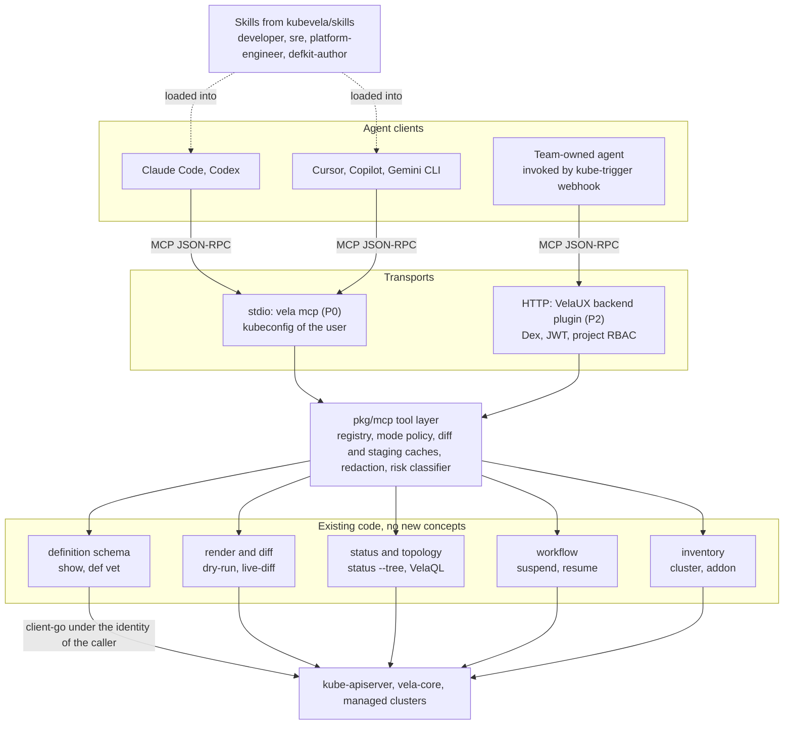
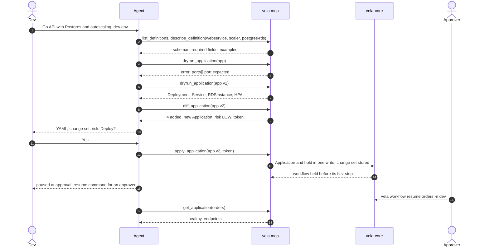

# KEP: Vela MCP - Agent-Operable Delivery, Diagnosis and Remediation

**Authors**: Anoop Gopalakrishnan

**Status**: Draft

**Created**: 2026-09-29

**Last Updated**: 2026-11-16

> **Status**: Design proposal. Tool names, schemas and flag names may change during
> implementation and community review. Nothing here is committed behaviour.

## Summary

`vela mcp` exposes KubeVela to AI agents over the Model Context Protocol from inside the
`vela` binary. It wraps code that already ships (definition schemas, dry-run, live-diff,
status tree, VelaQL views, workflow suspend and resume) as deterministic tools — fifteen
at P0, growing through the phased table below —
with read-only as the default and every write rendered, diffed and gated through the
Application's own workflow. Every response states the versions it ran against, when the
data was observed, and which objects each explanation was derived from. A companion repository holds skills, client setup templates
and an evaluation suite that runs across model families.

Three things make this more than a Kubernetes MCP with an OAM accent:

| Bet | What it means for the user |
|---|---|
| Render and diff before anything exists | An agent cannot apply what it has not shown as a resource-level change set with a risk class |
| Writes pause for a human, outside the spec | An agent-initiated change holds before its first workflow step until someone with resume rights confirms; the Application's declared workflow is never edited, and the agent cannot resume by default |
| Platform engineers get an authoring loop | defkit in Go, `vela def vet`, dry-run against local definitions, consumer impact before a change |

For incident work, Vela MCP is the connective piece of a reference stack with a read-only
Kubernetes MCP and the team's observability MCP. It hands them the keys (labels, pods,
windows) rather than owning telemetry.

## Motivation

- **Agents hallucinate OAM.** Component and trait parameters live in CUE schemas a model
  cannot recall at useful fidelity. Without a schema tool the agent guesses and finds out
  at apply time.
- **Discovery is KubeVela's adoption ceiling.** A new user learns Application, Definition,
  Trait, Policy and Workflow before the first deploy. An agent that discovers and composes
  interactively removes most of that ramp.
- **No agent surface exists anywhere in the ecosystem.** Across the kubevela and
  kubevela-contrib organisations there is no MCP, LLM or agent work.
- **Agent access without approval is the common failure.** Most platform MCP servers
  expose direct create, update and delete tools, so an agent change reaches the cluster
  with no preview and no gate. KubeVela already has workflow suspend, live-diff and
  dry-run. Composing them gives approval and audit without inventing anything.

### Goals

1. From "I need a service with X and Y" to a valid, rendered, diffed Application without
   the user knowing OAM vocabulary.
2. No agent write reaches a cluster without a rendered diff; none reaches production
   without a human gate or a Git handoff.
3. Explain a degraded Application from KubeVela's own dependency graph, and hand the
   observability MCP exact labels and time windows to continue.
4. A platform engineer authors, validates and renders a new capability with defkit through
   an agent in one sitting.
5. Identical authorisation across CLI, VelaUX and MCP. The agent is the user.
6. Works with every mainstream MCP client and any model. No model-provider dependency in
   KubeVela.

### Non-Goals

1. Owning or proxying log search, metrics, traces, cost or DORA data. A bounded, redacted
   log tail for a managed component is in scope because it comes from the same API server
   read as status; search, retention and correlation across time are not.
2. Wrapping raw Kubernetes CRUD, `exec` or `port-forward`.
3. A built-in LLM agent in vela-core or VelaUX.
4. Replacing YAML, VelaUX or GitOps as the primary developer interface.
5. Cluster-fleet tools before the Cluster Infrastructure KEP lands. They are in scope
   afterwards; see [Future scope](#future-scope-cluster-fleet-tools).
6. Validating definition parameters at admission. That belongs in its own proposal and
   helps humans as much as agents; this KEP consumes it when it lands, see
   [Accuracy contract](#accuracy-contract).

## Proposal

### Mental model



Every tool maps to a code path the CLI already has. Handlers call the packages those
commands use, such as the query collector for resource trees and the dry-run package for
renders. Like live-diff, `diff_application` compares the document with the stored
ApplicationRevision, rendering that base with the definitions the revision recorded, so a
definition updated since then shows up in the change set and is named as its source. It
compares objects field by field, because live-diff returns text for a terminal and the risk
classifier needs structured changes. Handlers never shell out and never call a model.

### Principles

1. **KubeVela computes, the model explains.** Risk classes, diffs and root-cause ordering
   come from deterministic code.
2. **Read-only until an administrator says otherwise.** Write tools are absent from
   `tools/list` unless enabled at server start. No runtime toggle a prompt could flip.
3. **Every write is computed, then confirmed by a human.** `apply_application` requires a
   token from a `diff_application` call on the same content in the same session. The token
   binds the exact document to the base revision it was diffed against; it does not prove
   anyone read the diff. Human confirmation comes from the mode: pull-request review for
   `gitops`, the cluster-side hold for `gated`, and a server-written prompt for `direct`.
4. **The agent is the user.** Same kubeconfig, impersonation, RBAC and audit as `vela`.
5. **No new vocabulary.** Tool names use definition, application, workflow, cluster, addon.
6. **Every answer says where it came from and how fresh it is.** Status tools read live
   from the API server, never from an informer cache, and every response carries the
   objects it was derived from and the time they were observed. An explanation that cannot
   cite an object says "unknown" for that part instead of inferring it.
7. **Version-aware.** The server knows the vela-core version, the CLI version, the
   Kubernetes version of every cluster it touches and the feature gates that change
   behaviour, and it includes them in responses so the model explains the system that is
   actually running, not the one in its training data.
8. **Follow existing practice, never steer.** Workloads keep their current form, new work
   follows the repository and namespace, and KubeVela is suggested unprompted only on a
   blank start where it is installed. Migration happens only on request. Choices with
   cost or ownership consequences are the user's unless the platform has decided them.
9. **Diagnoses descend the stack.** KubeVela is the first interface the user touches, so a
   diagnosis does not stop at "the resource is not ready". Every classified finding names
   the layer that owns the fix — `application-spec`, `controller`, `external` or
   `platform` (controller is reserved until the sweep attributes a cause to a controller's
   own behaviour; external is the system the controller reconciles against, a cloud
   account as much as a certificate authority or a DNS provider) — and claims scope only
   as far as its evidence reaches: a per-Application read says `single-resource`;
   account-wide is said only by a sweep across the family's resources, and only for
   resources that share one credential identity as far as the family's convention shows
   it. The chain ends in hand-off handles (the
   owning controller, the API group, the window) that an observability server can act on,
   never in "unknown" where a pointer exists. What a status reader cannot see is named as
   such: a controller's client-side rate limiter surfaces no error in any condition, so
   saturation there is observability territory.

### Tools

| Tool | Class | Wraps | Phase |
|---|---|---|---|
| `get_platform_info` | read | `vela version`, vela-core Deployment image and flags, feature gates, Kubernetes version per cluster, enabled addons with versions, controller health; for a given namespace, the delivery practice in use and whether the caller may create plain workloads; for a given cloud service, the installed provisioner — the cloud's own controller first (ACK on AWS, Config Connector on GCP, Azure Service Operator on Azure), then Crossplane — with a kind's CRD spec schema when the kind is given, or what to install; for ACK it reads the resolved controller Deployment's endpoint override and names it when one is set, so a verification against an emulator does not read as one against the cloud — and when that lookup cannot be certain it says so in a warning rather than implying cloud access (other families' overrides are not yet probed) | P0 |
| `list_definitions` | read | `vela def list`, `vela components`, `vela traits`; filtered by what a definition provides, with the platform's default for the namespace marked | P0 |
| `describe_definition` | read | `vela show`; CUE parameters as JSON Schema, required, defaults, examples, current revision | P0 |
| `explain_definition` | read | `vela def get` + static inspection of the template, which works even when required parameters have no default: what kinds it produces, which parameters drive which fields, health and status rules, restrictions, revision history, consumer count; plus findings about the definition's own rules, such as a component whose template emits auxiliary outputs while its health policy reads `context.output` only or is absent, so the component reports healthy before its members exist and releases everything that depends on it | P0 |
| `list_applications` | read | `vela ls` | P0 |
| `get_application` | read | Live Application + status; endpoints from VelaQL `endpoints` view | P0 |
| `explain_application` | read | `status --tree --detail`, VelaQL `resource-tree`, events; dependency walk; every claim cites an object | P0 |
| `get_managed_resource` | read | ResourceTracker-scoped live GET of any managed object in its cluster; refuses unmanaged objects; reads a Secret through the metadata API and returns only its metadata, never its data | P0 |
| `get_workflow` | read | `vela workflow` status | P0 |
| `get_logs` | read | VelaQL `component-pod` + bounded, redacted tail | P0 |
| `list_clusters` | read | `vela cluster list`; never credentials | P0 |
| `list_addons` | read | `vela addon list` | P0 |
| `dryrun_application` | plan | `vela dry-run`, including local definitions such as the CUE `vela def gen-module` writes for a defkit module; optionally sends each rendered object to the API server as a strict dry run, storing nothing, to check it against the installed CRDs; plus findings read from the rendered objects before redaction, such as a workload whose pod template reads a Secret or ConfigMap that another component produces, directly or through an exporter, without `dependsOn` on that component, since the default workflow applies components in parallel | P0 |
| `diff_application` | plan | `vela live-diff` + risk classifier; returns token | P0 |
| `apply_application` | write | `vela up` under mode policy | P0, flag |
| `find_definition_consumers` | read | Applications by component and trait type | P1 |
| `compare_definition_revisions` | read | Parameter and rendered-output diff between two DefinitionRevisions | P1 |
| `diagnose_application` | read | Root-cause walk of an unhealthy Application: family-owned resources — custom resources whose API group a controller family claims, the `standard-conditions` family included — read live, a bounded number per call, their conditions interpreted by the owning family's conventions (ACK `Terminal`, then `ReferencesResolved`, then `ResourceSynced`, so a `ResourceSynced` that stayed True behind an unresolved reference is reported as stale and the reference blocker is the diagnosis; Config Connector `Ready` with reason `UpToDate`; Crossplane `Ready` and `Synced`; standard-conditions `Ready` True, and `unknown` when no `Ready` condition exists); plain Kubernetes resources, and custom resources that write no conditions, keep the tree's pod-corrected health and Secrets are never diagnosed; plus correlated events and findings that each cite the object they came from. A family-owned resource that is not ready carries a `cause` when its family's error-bearing condition holds text (ACK `Terminal` or `Recoverable` message while True, the `ReferencesResolved` message while not True — which names `dependency-missing` by the family's own convention and is read ahead of a stale `ResourceSynced` — or the `ResourceSynced` reason while not True; Config Connector `Ready` reason and message while not True; Crossplane `Synced` message while not True, or its Cannot warning event when the message carries no recognisable error; standard-conditions `Ready` reason and message while not True, else the newest False condition that carries a message); a ready resource, or one whose only signal is a stale condition, carries no `cause`. The `cause` classifies that text as one of `throttled`, `quota-exhausted`, `auth`, `invalid`, `dependency-missing`, `conflict`, `unreachable` or `unclassified`, with the matched code token, transport phrase, Google API status, or the family condition that names the class itself (`ACK.ReferencesResolved`), a single `owner`, `scope: single-resource`, and the owning controller as a handle when this server can identify it; a class that is usually account-wide adds a `nextChecks` pointer to `diagnose_controllers` with the exact arguments, since one Application cannot show account scope. Exporters are described as well. An exporter is an ACK `FieldExport` where a controller still serves it, or any custom resource that writes a connection Secret: `writeConnectionSecretToRef` on Crossplane managed resources and Terraform Configurations, `publishConnectionDetailsTo` on Crossplane composites. It carries an `export` block naming the target Secret or ConfigMap and its namespace, the source field and target key where the exporter copies one value (a connection-Secret writer copies a set and names neither), and `written` from the exporter's own conditions; `written` is absent for a resource that writes no conditions and was judged from the tree, and for one whose readiness is unknown. The target is never read. A common-group kind is attributed to the controller of the service its spec names, a `FieldExport`'s source group or an `AdoptedResource`'s target group, and gets no controller at all when it names none. An export its exporter says is unwritten is tied to its source: a finding when the source is not ready or halted; a note when the source is ready, since the exporter's own conditions then name the problem, or when its state could not be read; and a finding, or a narrowing note, when the source was not among the diagnosed resources A plain workload that is not ready is read once more, inside the same live-read bound and only when the Application fills a Secret or ConfigMap, for what its pod template consumes through env values, `envFrom`, and Secret, ConfigMap and projected volumes, skipping references marked optional. A reference to an object another component fills, through an exporter for that key whose own conditions say it is unwritten or while that component's own resources are not ready or halted, becomes a finding that names the consumer, the producer and the layer that owns the fix: `application-spec` when the consumer declares no `dependsOn` on the producer, `platform` when it does and the producer's definition still reported healthy too early. A producer whose state is unknown is never blamed, a value read through env is fixed at container start while a mounted file updates in place, and a diagnosis narrowed to one component skips this read and says so | P1 |
| `diagnose_controllers` | read | Fleet health of the installed controller families: lists every served kind of every named family, built-in or profile, and for the `standard-conditions` family the API groups the caller names or that appear in Applications' applied resources (one list of Applications under the same budget, counted the same way), less every group a named family claims, so no resource is swept twice — cluster-scoped kinds, and namespaced kinds in the namespaces the caller may read — under one per-call budget that bounds the work, not only the answer: at most 500 resources read, every list call chunked with `limit` and the API server's continue token, and a wall-clock deadline; when the budget ends the response says `truncated`, carries listed-versus-read counts per family and a cursor (family, kind, namespace, continue token) the next call resumes from, and a kind or namespace the caller cannot list appears under `unknowns`, never as zero. Each resource read is classified with the same rules as `diagnose_application`, kept when the evidence its cause was read from falls inside the window (default one hour) — the condition's transition, or the event's last timestamp when the cause came from the Crossplane `Cannot` event fallback — with evidence that carries no timestamp kept, as `diagnose_application`'s one-hour read-time fallback treats it; a condition that stays not-True keeps its first transition, so a long-running error needs the wider window the caller sets, and aggregated by cluster, family, API group, class and credential identity with counts, first and last seen, sample resources and the owning Applications. Credential identity is what the family's convention exposes — the ACK controller Deployment for the service together with any per-namespace account mapping the namespace declares, the `ProviderConfig` a Crossplane resource references, the project a Config Connector resource or its namespace is annotated with — and is `unresolved` when the server cannot read it; a family with no credential convention, the `standard-conditions` family included, is always `unresolved`, so its aggregates claim at most `cluster-wide`. `scope` is `account-wide` only for an aggregate whose resources resolve to one credential identity and span two or more Applications, `cluster-wide` when the identity is unresolved and the spread crosses Applications, else `single-resource`; an aggregate of a usually-account-wide class at `account-wide` scope is an error finding. Endpoint provenance is stamped per aggregate from its API group's controller when the family identifies one, the same lookup `diagnose_application` makes per resource; an aggregate whose family identifies no controller carries that family's note instead | P1 |
| `diff_definition_impact` | plan | Blast radius of a definition change before it is applied: finds consumers the way `find_definition_consumers` does, renders a bounded number of them against the cluster's current definition and against a proposed copy supplied the way `dryrun_application` accepts local definitions, and returns a per-Application result. Changed consumers carry a change set and risk class, unchanged consumers are marked unchanged, base render failures carry a base render error, and proposed render failures carry their render error with no change set or risk class — a missing risk class for a render failure is a blocked consumer, never a safe one | P1 |
| `vet_definition` | plan | `vela def vet` | P1 |
| `stage_definition` | plan | Parses and validates a local definition (CUE as `vela def gen-module` writes it, or YAML) exactly as the plan tools do inline, caches it server-side, and returns a content-hash handle with the definition's kind and name. Every plan tool accepts handles wherever it accepts inline definitions, so a 30 KiB generated definition crosses the agent's context once per edit instead of once per call | P1 |
| `suspend_workflow`, `terminate_workflow` | write | `vela workflow` | P1, flag |
| `resume_workflow` | write | `vela workflow resume`; separate flag; denies the recorded initiator | P1, flag |

Deliberately absent: raw Kubernetes get and patch, exec, port-forward, addon enable,
cluster join, definition apply, and reading Secret data; a managed Secret's metadata is the
only Secret read a tool returns.

`diagnose_application` interprets where `explain_application` reports: the resource tree
has no health rule for most custom resources and defaults them to Healthy, so a resource
whose controller has stopped reconciling — a cloud database, a certificate, a route —
reads as fine in a plain tree. The diagnosis reads family-owned resources live, a bounded
number per call with anything unread named, while plain Kubernetes resources, and custom
resources that write no conditions, keep the tree's pod-corrected health and
Secrets are never diagnosed; each live read is interpreted by the conventions of the family
that owns its API group — a halted ACK resource (`ACK.Terminal`) or one the controller
cannot converge (`ACK.ResourceSynced` persistently false while the provider reports the
resource exists, the signature of a field the endpoint computes differently), a Config
Connector resource whose `Ready` reason is not `UpToDate`, a Crossplane resource
missing `Ready` or `Synced`. Every finding stays a cited observation; the conventions
decide only which conditions are worth citing and what their combination means.

Local definitions travel by reference, not only by value. An authoring loop renders the
same generated definition many times — dry-run, impact, diff, repeat after each edit —
and inlining it in every call spends the agent's context on boilerplate it never needs
to read. `stage_definition` stages the parsed definition under a content-hash handle
with a bounded TTL cache, the same pattern as the diff token; handles resolve inside
the same validation and size budgets as inline content, count toward the diff token's
local-definitions record identically, and expire to a clear error naming the tool to
call again. Handles also work on transports with no shared filesystem, which the
VelaUX phase needs; reading definition files from disk stays deliberately absent. The
stage cache lives in one server process and the stdio transport serves one caller, so a
handle is not an authorization boundary and must not become one by accident: the HTTP
transport binds staged entries and their lookups to the caller's principal and project
before it exposes this tool, and a handle never transfers across callers.

`diff_definition_impact` exists because a definition edit is the one change whose blast
radius the author cannot see from the document in front of them: the Applications it
breaks are other people's. It composes two capabilities this KEP already has — consumer
discovery and local-definition rendering — into the question a platform engineer
actually asks before `vela def apply`: "who uses this, and what changes for each of
them". A consumer the proposed definition no longer renders is reported as that
Application's render error, not as a tool failure, and such an entry carries no risk
class on purpose: the change blocks that consumer, and an agent must never read the
absence of a risk class as safety. The result mixes a live consumer scan with rendered
diffs; the envelope's source says mixed when both contributed, and the evidence lines
say which parts came from the live scan and which from renders. Only a bounded number
of consumers are rendered per call: the result is marked truncated when consumers were
found but not rendered, the count says how many, and an unrendered consumer's impact is
unknown, never assumed unchanged.

`explain_application`, `get_application` and `get_logs` return **correlation handles**:
cluster, namespace, pod names, the label set KubeVela stamps on rendered resources,
revision and apply time, a suggested time window, and a log selector string. These are
what the observability MCP needs to continue the investigation without re-deriving names.

### Accuracy contract

The server is only worth installing if an operator can trust what it says during an
incident. Four rules make that trust checkable rather than assumed.

**Every response carries an envelope.**

```json
"meta": {
  "velaCore": "v1.11.0",
  "velaCLI": "v1.11.0",
  "kubernetes": {"local": "v1.31.4", "prod-us-west": "v1.30.8"},
  "featureGates": {"ZstdApplicationRevision": true},
  "observedAt": "2026-10-13T09:42:17Z",
  "source": "live",
  "truncated": false,
  "warnings": []
}
```

`featureGates` repeats only the gates set away from their defaults; `get_platform_info`
lists every gate set on the controller.

`source` is `live` for a direct API server read, `rendered` for dry-run output, `mixed`
when a live read and a render both contributed — the evidence lines say which parts are
which — and `cached` only for definition schemas, which carry their DefinitionRevision so
staleness is visible. It always describes the data in the response. Where tool descriptions, read tools
or risk hints came from is reported separately in `servedData` (`builtin`, `addon` or
`addon-cached`, with the addon version and the cache age), so a stale addon cache never
makes live data look cached. Status tools never serve from an informer cache. `truncated` is set whenever a
line budget or size cap cut the data, so the model knows it did not see everything.

**Every explanation cites its evidence.** `explain_application` and `explain_definition`
return an `evidence` list alongside the narrative data: for each claim, the object
reference, the field or condition it was read from, and the timestamp on that object.
A claim without evidence is not emitted. When an object's own health check disagrees with
its pods, as for a Deployment that reports Healthy while every pod crash-loops, the server
reports the pods' state, marks the status as derived and keeps both facts. Where the server
could not determine something,
for example a provider condition that was not surfaced, it lists it under `unknowns`
instead of leaving a gap the model might fill.

**Families are controllers, not clouds.** A family is any controller that reconciles a
custom resource against something the Application does not own: a cloud account, a
certificate authority, a DNS provider, a message broker, a mesh or a network data plane.
The cloud provisioners with a convention of their own — ACK, Config Connector, Crossplane
— are the first built-in families because their conventions vary the most, and a family
is defined by its conventions, never by what it talks to. Azure Service Operator is
detected by `get_platform_info` but has no convention of its own here: it writes a
standard `Ready` condition with a reason and message, so its resources are read by the
standard-conditions family below and carry no controller handle until a profile names
one. The last built-in family is
`standard-conditions`: any custom resource in the Application's tree that no named family
claims and whose status carries `metav1.Condition` entries. It is read live under the same
bound; ready means a `Ready` condition that is True; with no `Ready` condition the
readiness is `unknown` and the resource is listed under `unknowns`, never Healthy; the
error text is the `Ready` reason and message while not True, else the newest condition
that is False and carries a message; the same rules classify it, and the family's
vocabulary adds the phrases its controllers write in lower camel case, which the token
steps cannot read — an ACME `rateLimited` error is `throttled` with owner `external`
through the phrase step, the way an AWS `Throttling` token is through the code step. That
family
covers cert-manager, external-dns, Gateway API implementations and most operators without
a profile, and it removes the tree's Healthy default for anything that writes conditions.
A controller that writes no conditions, or a thin status — a network policy whose
rejection appears only in the agent's log — is out of a status reader's reach; the
diagnosis says so and hands off to the controller's logs when a built-in or a profile
names the controller, the same rule as the client-side rate limiter. The owner `external`
names the system the controller talks to; it replaces `cloud`, because an ACME rate limit
or a DNS provider's expired credential sits in the same link of the chain as a cloud
throttle.

**Causes are classified, never guessed.** A family-owned resource's error text is
matched in four steps, and the first rule that matches names the class, the token it
matched on and the owner. Step one reads the code position: the token after "api error"
in an AWS SDK message, else the first CamelCase token immediately followed by a colon that
a rule names, dotted as EC2 writes it. An explicit provider code is the "api error" case:
the provider named this error itself, so when no rule names that token the result is
`unclassified` and steps two to four are skipped — no CamelCase token, transport phrase or
HTTP status elsewhere in the same message is read, because a message that carries an API
error completed its exchange and any transport text in it describes an earlier attempt,
and an identifier echoed in the prose must not assign a class. Text with no explicit code
continues: step two matches every CamelCase token in the text, step three transport
phrases such as "connection refused", step four a googleapi HTTP status. Text that reaches
the end with no match is `unclassified`, carries the redacted text as evidence and carries
no owner — the server does not infer who should fix what it could not recognise. A family
condition that names a class by its own convention — ACK
`ReferencesResolved` not True is `dependency-missing` — is read as that class with the
condition as the code. A rule names a token whole, or with a wildcard the rule declares,
and rules are tried in a fixed order in which `throttled` precedes `quota-exhausted`, so a
token both could claim goes to the throttle. Illustrative examples: a `Throttling`,
`TooManyRequestsException` or `RateLimitExceeded` token, or a `googleapi: Error 429`, is
`throttled` with owner `external` — `RateLimitExceeded` is a throttle though it ends in
LimitExceeded; `LimitExceeded` or `QuotaExceeded` is `quota-exhausted` with owner
`external`;
`AccessDenied`, `ExpiredToken` or a `googleapi: Error 403` is `auth` with owner
`platform`; `InvalidParameterCombination` or `googleapi: Error
400` is `invalid` with owner `application-spec`; a `NotFound` token or a Config Connector
`DependencyNotFound` reason is `dependency-missing` with owner
`application-spec`; `AlreadyExists`, `InUse` or `ManagementConflict` is `conflict` with
owner `application-spec`; `connection refused`, `no such host` or a TLS failure is
`unreachable` with owner `platform`. The rules are data, so a family can be described
rather than coded (see controller family profiles under Future scope). Verification is
stated per family and names what the controller was talking to: the ACK path is verified
end to end with the ACK controller in the loop against an endpoint that answers with AWS's
documented error bodies, not against an AWS account; a result's evidence names a confirmed
endpoint override, and a lookup that could not confirm one leaves a note instead. Config
Connector and Crossplane are verified by fixture from the message formats their
controllers' own source produces; the standard-conditions family is verified by fixture
from cert-manager's and the Gateway API's documented condition reasons and messages.
No family is verified against a cloud account, and the contract says so until one is.
This per-family statement is the verification ledger; the description the server serves
for `diagnose_application` repeats it. A cause adds the owning controller as a handle
whenever this server can identify the controller — today the ACK controller Deployment
the endpoint-provenance lookup selects; Config Connector, Crossplane and
standard-conditions causes carry a note instead, until a profile names the controller —
with a window that starts at the evidence: the condition's transition, or
the event's last timestamp when the cause was read from an event, or one hour before the
read when the evidence records no time. Crossplane writes the provider error into the
Synced message; when that message carries no recognisable error, the newest warning event
with a reason starting Cannot on the same resource — same cluster, namespace and
Kind/name — is read instead, and that event's time dates the cause.
The sweep pointer is emitted once per provider, family and class per diagnosis — per
family and API group when the family has no provider — and names diagnose_controllers as
a tool this server may offer. No rule in this release yields the owner controller; it is
reserved for causes the sweep attributes to a controller's own behaviour.
`diagnose_application` never runs the fleet sweep on its own: a per-Application
diagnosis stays bounded and cheap, and scope beyond one resource is claimed only when
`diagnose_controllers` has been called.

**Explanations are version-gated.** Behaviour that differs across releases is resolved
against the running version from the envelope, not against a fixed assumption. Examples:
how an unversioned definition reference resolves, whether `AuthenticateApplication`
applies resources as the creator, which workflow step types and policies exist. The
server ships a small table of version-dependent behaviours and consults it when building
`explain_*` output, and it says explicitly when a question cannot be answered for the
running version.

**Version mismatch is a finding.** When the CLI, vela-core, a definition's expected
controller version or a cluster's Kubernetes version fall outside their supported ranges
for each other, `get_platform_info` reports it and every other tool repeats it in the
envelope as a warning. Many production mysteries are version skew; the server should be
the first thing that notices.

**One schema for humans and agents.** `describe_definition` returns the parameter schema
the controller publishes for each definition. Today nothing rejects an undeclared or
mistyped parameter until render, so dry-run is the check the agent must pass. When
parameter validation at admission lands (separate proposal), the server serves that same
admitted schema, and an agent and a human get identical rejections for the same input
instead of the MCP being the only place the rules are applied.

The evaluation suite scores these rules directly: a fixture set of degraded Applications
with known causes where every emitted claim must resolve to a real object, a run against
two different vela-core versions where version-gated explanations must differ correctly,
and a check that no status response ever reports `source: cached`.

### Choosing an approach and a definition

The server supplies facts; the agent follows principle 8:

| Situation | The agent |
|---|---|
| The user names an approach | Does that, without comment |
| Changing something that exists | Keeps its current form |
| New work next to existing practice | Follows the repository and namespace |
| Blank start, KubeVela installed | Asks once, suggesting KubeVela; a platform-declared default replaces the question |
| Asked to migrate, either direction | Shows the conversion as a diff first |

`get_platform_info` with a namespace reports the practice there (`kubevela`, `kubernetes`,
`mixed`, `empty`, or `unknown` when a count failed, so the agent asks), the default a platform team declared with the namespace label
`app.oam.dev/delivery-default`, and whether the caller may create plain Deployments, so the
agent never offers an approach that would fail. The server's own instructions stay neutral.
Neither server writes plain Kubernetes objects: for that work the agent hands back the
manifests for the repository or the user's own pipeline, as gitops mode does for Applications.

Platform teams label definitions with `definition.oam.dev/provides` (for example
`postgres`) and mark defaults with the `definition.oam.dev/default-for` annotation.
`list_definitions` filters by `provides` and marks the default for the namespace. With a
default the agent uses it and names the alternatives; with several and no default, it asks
in chat, keeping confirmation prompts for writes. Unlabelled definitions, which today
includes the built-in ones, are returned by the same filter when their name or description
mentions the capability, marked so the agent confirms them.

### Write modes

| Mode | `apply_application` does | Default for | Moves forward by |
|---|---|---|---|
| `gitops` | Returns deterministic YAML and the diff; writes nothing | Applications marked GitOps-managed, and namespaces declared GitOps | Pull-request review |
| `gated` | Applies with a one-shot hold, so the workflow does not start until confirmed | Everything else | A human with resume rights |
| `direct` | Verifies the diff token, asks the user to confirm through the client, then applies | Only namespaces on an explicit allowlist that also do not match the production pattern; a namespace matching both is refused at startup | The user, through a prompt the server writes |

**Mode is decided per Application.** Namespace policy sets the floor. An Application can
tighten its own mode with an `app.oam.dev/agent-write-mode` annotation (`gitops` or
`gated`), read from both the live object and the submitted document, and the strictest of
the three wins. A marker can only tighten, never loosen, so a value in the input cannot
weaken the policy, and a team that manages one Application through Git while the rest of
the namespace is not gets `gitops` for that Application alone. Requested mode can be
downgraded by policy (direct to gated, gated to gitops), never upgraded. A HIGH risk class
always downgrades `direct` to `gated`, so a single confirmation never approves a deletion,
a placement change or a security-surface change.

**Direct mode confirms through the client, not the agent.** After verifying the token the
server sends an MCP elicitation request, and the client shows it to the user as a native
prompt the model cannot answer:

```text
vela: apply Application shop to team-a, direct mode, no approval step
  MODIFY Deployment team-a/shop
    spec.template.spec.containers[0].image  nginx:1.26 -> nginx:1.27
  Risk LOW: image-tag
  Base revision shop-v1. Token valid for 12 more minutes.
[Apply]  [Decline]
```

The server writes this text from the same change set it hashed into the token, so a model
cannot misdescribe the change, and an agent that chains `diff_application` and
`apply_application` in one generated script, as code-execution clients do, still stops at
the prompt. Accept applies; decline writes nothing and returns "declined by user". A
client that does not support elicitation cannot use `direct`. That request is refused
rather than downgraded, because a downgrade to `gated` would still write the Application:
nothing is applied, and the response names the modes this client can use instead. Direct is
refused the same way when the diff used local definitions the token does not bind, when the
render writes outside `--namespace`, or when a restricted server would run workflow steps
whose writes the diff cannot see. The
HIGH-risk downgrade above is different: it is policy, the response states the mode that was
used, and the hold still stops the change. Some harnesses accept prompts automatically in unattended modes. That is
the user's choice, equivalent to `--yes` on the CLI; unattended automation belongs in
`gated`, where the gate lives in the cluster rather than in the client. The prompt is a
confirmation, not authorisation: RBAC still decides what may be applied.

**Gated mode does not edit the spec.** Injecting a `suspend` step would change the
Application's declared intent: it would appear in revisions and rollbacks, and a restart
would replay it. Instead the server writes the submitted Application and a hold in the
same request:

```yaml
metadata:
  annotations:
    mcp.oam.dev/initiator: alice@example.com
    mcp.oam.dev/diff-token: sha256:...
    mcp.oam.dev/risk: LOW
    mcp.oam.dev/change-set: shop-mcp-3f9a
    app.oam.dev/hold: sha256:...
```

The hold does not predict a generation. An existing Application is updated only while its
UID, spec generation, labels and annotations still match the diff; the update carries the
current resourceVersion, and a conflict caused by a controller status write is retried
after the same checks pass against a fresh read. A new Application is created only if it
is still absent. Anything else fails and the agent diffs again, so the token is never
applied to a spec it was not computed for. The annotation only
requests the hold. When the controller first sees it, it writes the hold into the
Application's status, which only the controller writes, and it does this before starting
any workflow step for that generation: if the status write fails, the reconcile is
requeued and no step runs, so a crash or a failed write cannot let the first step start
unheld. From then on the status entry is what keeps the workflow suspended. Every
generation it reconciles while the entry is present starts suspended, whether or not a
later update still carries the annotation; a full-object update that drops it therefore
cannot release the change. A concurrent edit by someone else makes the controller hold
more, never less.

Confirmation uses the existing path. `vela workflow resume` lifts the workflow's
suspension exactly as it does for any suspended workflow, and nothing else. The controller
observes the resumed workflow, clears its own status entry and then removes the
annotation, so the controller remains the only writer of the hold. The other way out is to
reject the change: `vela workflow rollback` to the revision that was live before the hold
was set tells the controller the agent's change is abandoned, so it clears the hold and
runs that already-confirmed revision. A rollback to any other revision is held like any
other generation until someone resumes it. Because the hold lives outside the spec and is
cleared on confirmation or rejection, revisions never contain it, a restart after
confirmation does not pause again, and the next agent-free change runs normally.

**The approver sees the change, not just its class.** The server stores the change set it
diffed, redacted and bounded exactly as `diff_application` returned it, in a ConfigMap
owned by the Application and named in `mcp.oam.dev/change-set`, together with the token,
the base revision and the fired rules. The hold message points at it, `get_workflow`
returns it, and an approver without MCP reads it with
`kubectl get configmap <name> -o yaml`. The approver therefore resumes having seen the
same resource-level diff the agent showed, and can compare its base revision with the live
one before confirming.
This needs a small controller change, listed under [Milestones](#milestones) as a
prerequisite for gated writes.

The server strips any `mcp.oam.dev/*` annotation and any hold present in the submitted
Application and writes its own, so neither the initiator record nor the hold can be forged
by the input.

Where the gate is enforced, and where it is not: within the MCP path the server never
exposes `resume_workflow` unless started with its flag, so an agent confined to MCP cannot
resume. An agent that also holds the user's kubeconfig and a shell can run
`vela workflow resume`, because the agent is the user and the user may resume. That is a
property of the user's RBAC, not of this server. Deployments that need the gate to hold
against shell access must restrict who may resume at the cluster, for example an
admission policy that permits the resume annotation only from an approver group, which
then applies equally to humans. The skills forbid agents from resuming and the evaluation
suite tests for it, but those are behavioural controls and the KEP does not present them
as enforcement.

The **risk class** is the maximum over rules on the live-diff output, with every fired
rule listed: image tag only is LOW; scaling is LOW; a new Application with no existing
managed resources is LOW; config and env are MEDIUM; additions to an existing Application
are MEDIUM; policy, workflow and sources changes, image digest changes and component
changes that render the same objects are MEDIUM; any deletion, replace, placement change, security-surface change, stateful
change or removed gate is HIGH, including in a new Application. The classifier is a pure
function with golden tests.

### Identity

- **stdio (P0)**: the kubeconfig user, with `--as` and `--as-group` mapped to the existing
  impersonation support in `pkg/auth`. No listener, no OAuth.
- **HTTP via VelaUX plugin (P2)**: VelaUX already proxies backend plugins under
  `/proxy/plugins/<id>/` with Dex login, JWT and project RBAC. The plugin impersonates the
  VelaUX user. The `tools/list` response is filtered per caller with
  SelfSubjectAccessReview; the API server still enforces regardless.
- **prism (option)**: an aggregated API server inherits kube-apiserver authentication for
  shops without VelaUX. Documented only if an adopter asks.

No transport introduces a privileged service identity for agents.

### Reference stack

MCP servers do not call each other; the client loads several and the model chooses. So
the pairing is a tested combination, with boundaries written into tool descriptions and
skills.

| Question | Goes to |
|---|---|
| What does this Application deploy, where, in what state | Vela MCP |
| The live Deployment or Crossplane resource behind a component | Vela MCP, `get_managed_resource` |
| Nodes, quotas, an operator's own CRs, an unmanaged Ingress | Kubernetes MCP, read-only |
| Latency, error rate, traces, log search, alert history | Observability MCP (Grafana, Datadog, Prometheus) |
| Change anything an Application manages | Vela MCP, diffed and gated |
| Change anything else | Neither, in any documented configuration |

`vela` writes no client configuration, so it never tracks client formats or versions.
`vela mcp config` prints the server entry, either as the `mcpServers` JSON block most
clients accept or as the server command and arguments that go after a client's own `mcp add`,
POSIX shell-quoted so `eval` rebuilds exactly those arguments; a test round-trips hostile
values through a real shell:

```text
$ eval "claude mcp add --scope user kubevela -- $(vela mcp config --format command --namespace team-a)"
```

Per-client steps, skills installation and the companion servers, with the exact
third-party versions the evaluation suite last passed against, live in the
`kubevela/skills` repository, which moves at the clients' pace without a `vela` release.
Those instructions never store a third-party credential and never make the Kubernetes
MCP writable.

Honest boundary: the developer and platform-engineer loops are complete with Vela MCP
alone. The incident loop is only as good as the trio. Our target is the team that already
runs an observability stack and does not want a second one.

### Skills

| Skill | Teaches |
|---|---|
| `kubevela-developer` | Discover before drafting, dry-run until clean, diff before apply, stop at the risk summary, never resume |
| `kubevela-sre` | Explain first and take the handles; metrics, traces, logs through the observability MCP; managed objects through vela; rollback as a diffed change |
| `kubevela-platform-engineer` | Consumers before changing a definition, render a sample of consumers, inventory conventions |
| `kubevela-defkit-author` | defkit Go by default, CUE only on request; search the catalog first; real provider CRD shapes, using the provisioner the cluster already has, and the cloud's own controller (ACK, Config Connector, Azure Service Operator) only when there is none and the user names none; `go test`, `validate-module`, `gen-module`, dry-run with the server check; deliver by PR |

Skills follow the agentskills.io layout so Claude Code, Codex, Cursor and Copilot load them
unchanged. Third-party tool names live in a per-server appendix that `kubevela/skills`
keeps aligned with the pinned versions.

### Event-driven agents

kube-trigger already watches resources across clusters, filters with CUE and runs a
workflow step as its action. A webhook step calls whatever agent the team runs; that agent
comes back through the HTTP transport under a read-only identity. KubeVela gets an
SRE-agent experience with no model integration and no provider dependency.

### Future scope: cluster-fleet tools

Once the Cluster Infrastructure KEP lands, the same tool layer extends below the
Application without new principles. Every tool below maps to a CRD or controller that KEP
introduces, follows the same read, plan and write classes, and gates writes through the
approval and maintenance-window semantics that KEP defines for rollouts.

| Tool | Class | Wraps | Example question |
|---|---|---|---|
| `explain_cluster` | read | Cluster status, plane health, drift report, rollout state | Why was `claims-prod-usw2` not upgraded to blueprint v7 |
| `get_cluster_drift` | read | Drift reports and exceptions | Which production clusters have networking drift |
| `list_blueprints`, `describe_blueprint` | read | ClusterBlueprint and revisions | What does blueprint v7 change against v6 |
| `find_blueprint_consumers` | read | Clusters by blueprint and plane revision | Which clusters still run networking plane v3.4 |
| `plan_blueprint_rollout` | plan | Blueprint resolver, compatibility checks, wave computation | What happens if the Cilium plane moves from 1.18 to 1.19 |
| `start_fleet_rollout` | write | ClusterRollout with approval gates and maintenance windows | Roll it to two dev clusters, then staging, then five percent of production |

Correlation handles gain cluster-plane identifiers so the observability MCP can answer
questions about a plane upgrade the same way it does about an Application revision. The
`kubevela-cluster-operator` skill joins the skills repository at that point. None of this
starts before the CRDs exist; it is listed here so the tool layer is not designed in a way
that would have to be rebuilt to accommodate it.

### Future scope: controller family profiles

The conventions that interpret a family — its API-group suffixes, which condition types,
statuses and reasons mean ready, not ready or halted, which condition fields and event
reasons carry the external system's error text, its error-code vocabulary and owner
overrides, an install hint, and where its controller's endpoint configuration and
Deployment live — are data. Today the error-code vocabulary is a Go table; the readiness
conventions, error-field sources and controller locators are Go code, and move into the
same declarative shape when profiles land. A later release lets a platform team, or a
vendor shipping its own controller, declare a family without a change to this server — a
cloud provisioner, a certificate issuer, a network policy engine alike — or refine how the
standard-conditions family reads a group it names, such as which condition means ready
and where its controller runs so a cause can carry a handle: a profile object the
server loads at start, validated against a schema, that populates the same tables the
built-in families use. When profiles land, the built-in families will be expressed in the
same schema and loaded through the same path, so the plug-in route will be the one the
first-party code exercises. A
profile is never executable: it names conditions and tokens; the server never runs vendor
logic and a profile cannot widen what the server may read. A profile that claims a suffix a
built-in family owns overrides it only when it says so explicitly, and `get_platform_info`
warns that the built-in is shadowed. Whether the object is a CRD or a labelled ConfigMap is
an unresolved question below. A profile can only classify what the controller writes into
status; a controller that hides a throttle behind a generic reason is fixed in that
controller, not in a profile.

### Repository placement

| Lives in | Contents | Why |
|---|---|---|
| `kubevela/kubevela` | `references/cli/mcp.go`, `pkg/mcp`, `hack/docgen/mcp` | Handlers are the CLI; zero-install `vela mcp`; one release train; separate repos in this org have gone stale |
| new `kubevela/skills` | Skill files, server appendices, client setup templates, version pins, stub observability MCP, evaluation harness | Moves at MCP-ecosystem speed; no Go build; needs model API keys for nightly evaluation |
| `kubevela/velaux` (P2) | `plugins/vela-mcp` backend plugin | Reuses Dex, JWT and project RBAC that already exist |

A CODEOWNERS entry for `pkg/mcp` and `references/cli/mcp.go` gives the work its own review lane
without its own repository. Precedent: `vela def gen-api` lives in core, the generated SDK
lives in kubevela-contrib.

### Release cadence

Shipping in the binary ties fixes to the `vela` release train, which is slower than the MCP
ecosystem moves. Most of what changes often is already read live: definition schemas, CRD
shapes, feature gates and versions never come from the binary. What is compiled in is the
handlers, the tool descriptions and the policy logic. The split:

| Stays in the binary | Served as data by an optional `vela-mcp` addon |
|---|---|
| Every handler that reads or writes the API server | Tool descriptions and examples, with the binary's copy as the default |
| Namespace allowlist, Secret handling, redaction, mode policy, token checks | Additional read-only tools expressed as VelaQL views, evaluated with read-only providers only |
| The classifier's rules and every HIGH rule | Risk hints that can only raise a class, never lower one |

`vela mcp` is complete without the addon: built-in defaults are the path every release is
tested on, and `get_platform_info` only reports which data source is in use. With the
addon, a platform team installs it once per control plane and developers' CLIs pick it up
on the next start. Served data carries the vela-core version and minimum CLI version it was
written for; a CLI ignores entries it does not understand and says so in the envelope. The
CLI caches what it last saw with that stamp and reports `servedData: addon-cached` with its
age when the cluster is unreachable.

VelaQL views are CUE that the CLI evaluates, and the standard view runtime wires in
handlers that apply and delete. Served views are therefore evaluated against a separate
provider set containing only the read handlers (`get`, `list` and the query providers),
and a view that references any other provider is rejected when it is loaded, never at
call time. Served views also never see more than the built-in tools: their `get` and
`list` providers refuse Secret kinds before the request and return ConfigMaps as keys only,
the namespace allowlist applies to every object they read, and their results pass through
the same redaction and size bounds as every other response before they leave the server.
Descriptions and risk hints are data and are validated against a schema. With
that restriction nothing served can write to a cluster or weaken a security rule, which is
what lets a platform team ship the addon on its own cadence.

The addon helps installs with a platform team. Everyone else still gets fixes at the CLI's
cadence, so P0 also proposes patch releases of `vela` for changes under `references/cli`
and `pkg/mcp` between minor releases.

## Examples

### Compose, validate, gated deploy



### Explain a degraded Application

```text
> Why is claims-service degraded in prod?

claims-api        Waiting     dependsOn -> claims-db
claims-db         Unhealthy   RDSInstance/claims-db
  condition       Creating    "DB subnet group claims-prod covers one AZ; two required"
workflow          Blocked     step deploy-prod-us-west
traffic           Unchanged   previous revision still serving

Root cause is the database subnet group, not the API. Nothing was changed.
Handles: cluster=prod-us-west ns=claims pods=[claims-api-7c9...] window=09:37-now
Evidence: Application/claims-service .status.workflow.steps[deploy-prod-us-west] @09:39:12
          RDSInstance/claims-db .status.conditions[Ready=False] @09:39:40
          Event claims-db.17f3 "DB subnet group claims-prod covers one AZ" @09:39:41
Unknowns: none
Running: vela-core v1.11.0, prod-us-west Kubernetes v1.30.8, AuthenticateApplication=false
```

The division of labor: `explain_application` reads the recorded status, workflow
steps, the VelaQL resource tree, component definitions and recent events, and returns
every component with its declared `dependsOn` and `inputs` edges, live resource health,
and findings ordered by severity. `diagnose_application` interprets: it walks the
managed-resource inventory, reuses tree health for plain Kubernetes resources, and
live-reads a bounded set of provider resources to classify their conditions — explain
reports, diagnose interprets. `diagnose_application` carries endpoint provenance: an ACK
resource whose controller is confirmed to call an endpoint override is stamped with that
endpoint, because conditions read through an override describe the emulator's view, not
the cloud's; when the lookup cannot be certain it records that as a note rather than
implying cloud access. `explain_application` does not carry this stamp. Neither tool elects a single root-cause component or
reports traffic state; the agent draws those conclusions from the dependency edges and
workflow phase in the response, as the transcript above shows. Reads are deterministic
and bounded.

A cause reads as a chain, each link cited. With an RDS API that throttles every caller in
the account:

```
symptom      Application orders-prod is NotReady; component "db" blocked
condition    DBCluster default/orders-db: ACK.Recoverable=True "Throttling: Rate exceeded"
cause        throttled (Throttling) — owner: external; scope: single-resource
next check   confirm the scope with diagnose_controllers when this server offers it: provider aws, family ack, window 1h
hand-off     controller ack-system/ack-rds-rds-chart, selector app.kubernetes.io/name=rds-chart, window 09:12–09:42Z
```

`diagnose_controllers` then answers the scope question the per-Application view cannot:
one aggregate for `rds.services.k8s.aws` × `throttled`, fourteen resources across six
Applications in the last hour, all reconciled by the one RDS controller whose namespaces
declare no other account, so `scope: account-wide`, with the same controller handle. Had
two of those namespaces mapped to another account, they would form a second aggregate with
its own scope rather than widen the first. The
same shape applies to an exhausted quota, expired provider credentials, an endpoint that
stopped answering, or a dependency that does not exist; only the class, owner and
guidance change.

The chain is the same when the controller is not a cloud provisioner. A certificate
issued through an ACME account that has hit its issuance limit:

```
symptom      Application web-prod is NotReady; component "tls" blocked
condition    Certificate web/tls-cert: Ready=False reason Failed "… urn:ietf:params:acme:error:rateLimited: too many certificates already issued …"
cause        throttled (rateLimited) — owner: external; scope: single-resource
next check   confirm the scope with diagnose_controllers when this server offers it: family standard-conditions, group cert-manager.io, window 1h
hand-off     no controller handle: the standard-conditions family names no controller; a profile for cert-manager.io can name it
```

The Certificate was read by the standard-conditions family, so a sweep can claim
`cluster-wide` only when its unresolved-identity aggregate spans two or more Applications;
for this single Application it stays `single-resource`, and the hand-off is a note until
a profile names the controller.

## Alternatives considered

| Alternative | Why not |
|---|---|
| Rely on a generic Kubernetes MCP | It cannot render, diff, or know what an Application manages; agents would still invent OAM parameters |
| Separate `vela-mcp` binary and repository | Must import core as a module (lockstep, replace directives), loses zero-install, and ecosystem repos here go stale |
| Build a semantic API layer first, then MCP on top | Months of new concepts before any user value; P0 maps to existing code and can ship in one release |
| Built-in agent in VelaUX | Model-provider dependency, agent-runtime maintenance, and no portal team to carry it; kube-trigger plus the team's own agent covers the need |
| Expose every CLI flag as a tool | Large surfaces degrade weaker models and cost tokens; the fifteen well-described P0 tools evaluate better |

## Risks

| Risk | Mitigation |
|---|---|
| Tool descriptions suit one model and not another | Cross-model evaluation in CI from P0; descriptions are code with tests |
| Secrets leak through tool output | Redaction on every response with negative tests |
| Agents resume their own gates | `resume_workflow` off by default; denies the recorded initiator |
| An agent applies a change no human looked at | Token binds content only; `direct` requires a server-written elicitation prompt and refuses clients without it; HIGH risk never goes direct; evaluation includes a code-execution client chaining diff and apply |
| Agents patch managed resources through the Kubernetes MCP | Setup configures it read-only; skills state the boundary; evaluation counts wrong-server calls |
| Third-party MCP tool names or auth drift | Version pins per release; server appendices separate from skill bodies; stub mirrors the pins |
| Scope creep toward semantic-API tools, or cluster-fleet tools before their CRDs exist | Every P0 tool must map to an existing code path; cluster-fleet tools start only after the Cluster Infrastructure KEP lands |
| A custom resource read by the standard-conditions convention is misread | Readiness is `Ready` True only, and no `Ready` is `unknown`, never Healthy; error text is read only from a not-True condition that carries a message; a profile overrides the convention for a group it names |
| A cause is classified from text a controller writes inconsistently | Rules match the provider's own code tokens, not prose; unmatched text is `unclassified` with no owner; the verification ledger names what each family was verified against, and none against a cloud account yet; a controller that hides errors behind generic reasons gets an issue filed against it, not a heuristic here |

## Milestones

| Phase | Scope | Exit criteria |
|---|---|---|
| P0, KubeVela 1.12 | `vela mcp` stdio; fifteen tools including `get_platform_info` and `explain_definition`; response envelope with versions, freshness and evidence; correlation handles; mode policy; risk classifier; redaction; `vela mcp config`, with per-client steps in `kubevela/skills`; developer, SRE, platform-engineer and defkit-author skills; the documented scenarios; velad quickstart; evaluation harness and stub observability MCP | Scenarios pass on three model families; new user completes compose-to-deploy on velad in under ten minutes through `gitops` or confirmed `direct`; incident scenario completes with zero manual lookups; every explain claim in the degraded-Application fixtures resolves to a real object |
| P1 | Controller hold hook and `gated` mode with stored change sets; `find_definition_consumers`, `vet_definition`, `diagnose_application` with cause classification and the standard-conditions family, `diagnose_controllers`, `diff_definition_impact`, `stage_definition` with handle support in every plan tool, workflow suspend and terminate, resume behind flag; `vela-mcp` addon for served descriptions, read-only VelaQL tools and risk hints; kube-trigger webhook recipe | New user completes compose-to-gated-deploy on velad in under ten minutes; a concurrent edit during a gated apply is held, never run unconfirmed; definition authoring and impact scenarios pass; the degraded-cloud-resource fixture (a provisioner that halted or cannot converge) is root-caused by `diagnose_application` with zero manual lookups; one adopter runs the trigger recipe |
| P2, after VelaUX catch-up | VelaUX backend plugin over streamable HTTP; per-caller tool filtering; read-only assistant panel | Hosted client logs in through VelaUX and gets the same allow or deny as the CLI |
| P3, after the Cluster Infrastructure KEP | Cluster-fleet tools from the Future scope section; cluster-plane handles; `kubevela-cluster-operator` skill | Fleet scenarios pass on three model families; a rollout started through an agent pauses at every approval the KEP defines |

P0 does not depend on VelaUX and should not wait for it. P3 does not start before the
cluster CRDs exist.

Three open issues break code paths P0 wraps and are prerequisites for it:

| Issue | What it breaks | Tool affected |
|---|---|---|
| 6731 | `vela dry-run --offline` returns empty output since 1.10.2 | `dryrun_application` without a cluster |
| 6847 | `vela show` omits parameters for workflow steps that import `vela/kube` | `describe_definition` |
| 5767 | OpenAPI schema generation fails on CUE constraints such as `>=1 & <=3599` | `describe_definition`, and the capability snapshot VelaUX reads |

One controller change is a prerequisite for gated writes, not for the read and plan
tools. It is scheduled in P1 together with `gated` mode:

| Change | Why | Until it lands |
|---|---|---|
| Honour `app.oam.dev/hold`: persist it in status before any step of that generation starts (requeue on write failure), keep every reconciled generation suspended while the entry exists, and clear it after observing a resume or a rollback to the pre-hold revision | Gated mode without editing the Application's workflow | `apply_application` offers `gitops`, and `direct` on clients that support elicitation; requests that would be `gated`, including every HIGH risk change, fall back to `gitops` |

Parameter validation at admission is not a prerequisite. It is a separate proposal that
improves accuracy for humans and agents alike, and the server serves its schema when it
exists.

## Unresolved questions

1. Confirm agents cannot resume workflows by default and self-resume is a sandbox-only flag.
2. Whether to pursue prism as a second HTTP host, or document VelaUX only.
3. Opt-in telemetry, or measure through the scenario suite and adopter registry only.
4. Which third-party servers `kubevela/skills` pins in P0: containers/kubernetes-mcp-server,
   grafana/mcp-grafana, Datadog MCP, with Prometheus at P1.
5. Owner and scope of the VelaUX catch-up release that P2 depends on.
6. Names of the per-Application mode marker, the hold and change-set annotations, and
   whether the hold belongs in the workflow library rather than the Application controller.
7. Whether patch releases for `references/cli` and `pkg/mcp` follow the regular patch
   train or a separate one.
8. Names of the `provides` label, the `default-for` annotation and the namespace
   `delivery-default` label, and whether KubeVela's built-in definitions ship with
   `provides` labels in the same release.
9. Whether a controller family profile is a cluster-scoped CRD (`ControllerFamily`) or a
   labelled ConfigMap in `vela-system`, and how a vendor's chart ships one.
10. Whether `diagnose_controllers` sweeps every managed cluster by default or only the
    control plane with an explicit cluster list; the current multi-cluster posture favours
    the latter.
11. Whether the standard-conditions family should read `Accepted` or `Programmed` as
    readiness when a resource writes no `Ready` condition, as Gateway API resources do, or
    leave that to a profile for each such group.

## References

- Model Context Protocol Go SDK: https://github.com/modelcontextprotocol/go-sdk
- Agent skills specification: https://agentskills.io
- containers/kubernetes-mcp-server, grafana/mcp-grafana, Datadog MCP server
- KEP: Definition Kit (defkit), `design/vela-cli/kep-defkit.md`
- KEP: Cluster Infrastructure Abstraction, `design/vela-core/kep-cluster-infrastructure.md`
