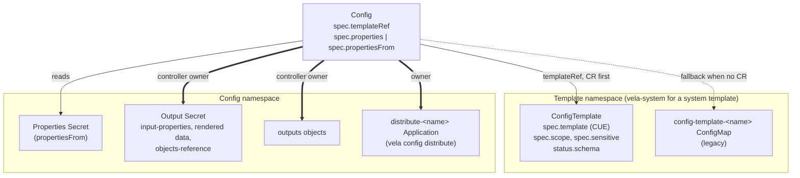
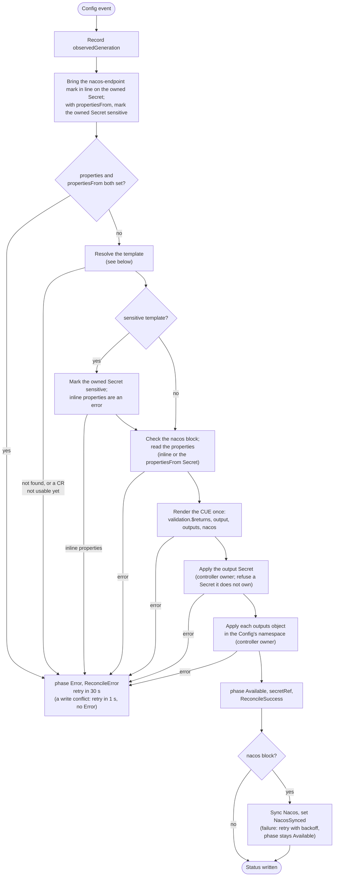
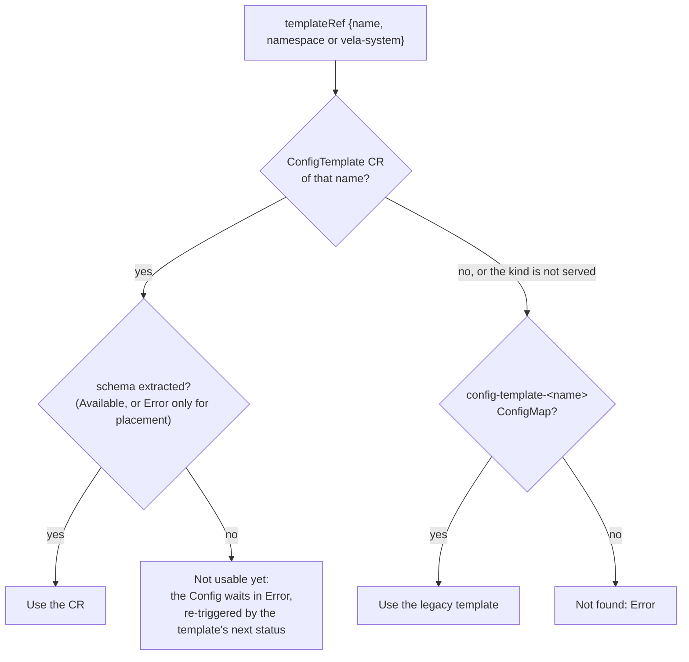

# Design 01: CRD-based Config Management (`config.oam.dev/v1alpha1`)

Companion design note to [KEP-2.18](../README.md). See the [design index](./README.md).

- Owner: Anish Bista (@anishbista60), Jerrin Francis (@jerrinfrancis)
- Date: 2026-08-12
- Status: Implemented (KubeVela v1.12)

### Introduction

This note describes the `config.oam.dev/v1alpha1` API group: two CRDs, `ConfigTemplate` and
`Config`, their two reconcilers and their two validating webhooks. They replace the 1.11 pattern of
storing config templates as labelled `ConfigMap`s and configs as labelled `Secret`s, which keeps
working alongside them ([Design 02](./02-backward-compatibility-and-cli.md)) until it is migrated
([Design 03](./03-migration.md)).

### Background

KubeVela's Config Management (`vela config` / `vela config-template`) had no Kubernetes API types of
its own in 1.11. A config template was a `ConfigMap` named `config-template-<name>` carrying the
`config.oam.dev/catalog: velacore-config` label, and a config was a `Secret` with the same label.
All of the logic that created, validated and rendered them lived in `pkg/config.Factory`, called
directly by the `vela` CLI, VelaUX and the workflow steps.

This had four problems:

1. **No proper API types.** `kubectl get configs` returned nothing; configs were indistinguishable
   from any other Secret without inspecting labels. No schema, no `kubectl explain`, no status,
   no clean integration point for GitOps tooling.
2. **Validation only ran in the client.** The CUE schema check (`ValidatePropertiesWithCueX`) and the
   template's own `validation.$returns` ran inside `Factory.ParseConfig`. A config Secret created by
   any other path, a direct `kubectl apply` say, bypassed validation entirely.
3. **Nothing reconciled a config after it was written.** The output Secret, the `outputs` objects
   and the Nacos publish were written once, from the client's machine. A deleted or edited output
   stayed that way; a Nacos publish happened only if the CLI ran it.
4. **No first-class place for sensitive input.** The properties and the rendered output were stored
   together in one Secret, and there was no way to source the properties from a Secret that someone
   else manages.

### Goals & Non-Goals

**Goals**

- `ConfigTemplate` and `Config` as CRDs with controllers, so `kubectl get`/`describe`/`explain`
  work and the objects carry status and conditions.
- The same validation for every entry point (CLI, workflow step, VelaUX, `kubectl apply`, GitOps),
  enforced at admission, and repeated by the controller wherever it can be.
- A Config's properties sourced from an existing Secret (`spec.propertiesFrom`) instead of being
  written inline.
- The rendered result (output Secret, `outputs`, Nacos) kept in line with the Config by a
  reconciler, not written once by a client.
- Full backward compatibility with the 1.11 storage, and a migration path from it
  ([Design 02](./02-backward-compatibility-and-cli.md), [Design 03](./03-migration.md)).

**Non-Goals**

- Removing the legacy ConfigMap/Secret storage, or a deprecation timeline for it.
- Changes to multi-cluster config distribution: `vela config distribute` keeps creating an
  Application that ships the output Secret; the Application is now owned by the Config.
- VelaUX changes.

### Proposal

#### Object model



Deleting a Config removes its output Secret, its `outputs` and its distribution Application by
garbage collection. Neither CRD has a finalizer. A Nacos entry the Config published stays in Nacos
([Design 06](./06-nacos-expanded-writer.md)).

#### API types

Both CRDs are namespaced, in the `oam` category, under `apis/config.oam.dev/v1alpha1/`. The CRD
manifests are `charts/vela-core/crds/config.oam.dev_configtemplates.yaml` and
`config.oam.dev_configs.yaml`.

```go
// +kubebuilder:validation:XValidation:rule="!has(oldSelf.sensitive) || !oldSelf.sensitive || (has(self.sensitive) && self.sensitive)",message="sensitive cannot be changed from true to false"
type ConfigTemplateSpec struct {
    Template    string              // required; CUE, the same format as the legacy ConfigMap's "template" key
    Scope       ConfigTemplateScope // "system" | "namespace", default "namespace"
    Sensitive   bool                // once true, never false again
    Alias       string
    Description string
}

type ConfigSpec struct {
    TemplateRef    *ConfigTemplateReference // {name, namespace}; namespace defaults to vela-system
    Properties     *runtime.RawExtension    // inline; mutually exclusive with PropertiesFrom
    PropertiesFrom *PropertiesReference     // secretRef{name, key}; key defaults to "properties"
    Alias          string
    Description    string
}
```

**ConfigTemplate** (short name `ct`; columns `SCOPE`, `PHASE`, `AGE`)

| Field | Meaning |
|---|---|
| `spec.template` | `template: {parameter, output, outputs?, nacos?, validation?}`, unchanged from 1.11 |
| `spec.scope` | `namespace` or `system`; `system` is valid only in `vela-system` ([Design 04](./04-template-scope-and-access.md)) |
| `spec.sensitive` | Configs from it are sensitive; the CEL rule above refuses turning it off on Kubernetes 1.25+, the webhook on any version ([Design 05](./05-sensitive-data.md)) |
| `status.phase` | `Available` or `Error` |
| `status.schema` | the OpenAPI v3 schema extracted from `template.parameter` |
| `status.conditions` | `Synced`: `ReconcileSuccess`, or `ReconcileError` with the message |

**Config** (short name `cfg`; columns `TEMPLATE`, `PHASE`, `AGE`)

| Field | Meaning |
|---|---|
| `spec.templateRef` | the template to render; immutable after create. Empty: the properties are stored as they are, with no render |
| `spec.properties` | inline properties, any JSON |
| `spec.propertiesFrom.secretRef` | a Secret in the Config's namespace whose key holds the properties as JSON. Always makes the Config sensitive |
| `status.phase` | `Available` or `Error` |
| `status.observedGeneration` | the generation the status describes; a reader waiting for `Available` (the `create-config` step) waits for the current generation |
| `status.secretRef` | the output Secret |
| `status.expandedWriter.nacos` | the last confirmed Nacos sync: `dataId`, `group`, `contentHash`, `endpoint`, `endpointHash`, `lastSyncTime` |
| `status.conditions` | `Synced`; `NacosSynced` for a template with a `nacos` block |

#### ConfigTemplate reconciler

`pkg/controller/config.oam.dev/v1alpha1/configtemplate/`. It parses the CUE, extracts the
OpenAPI schema from `template.parameter` into `status.schema` and sets `Available`. A parse or
schema failure clears the schema and sets `Error`. A `system` template outside `vela-system` (one
that reached the cluster with the webhooks off) is `Error` with its schema kept: readers then treat
it as namespace-scoped. It reconciles on ConfigTemplate events only: no requeue, no finalizer.

#### Config reconciler

`pkg/controller/config.oam.dev/v1alpha1/config/`. One pass:



**Template resolution** (`pkg/config/resolve.go`, `ResolveConfigTemplate`) is shared by the
reconciler, the Config webhook, the CLI and the workflow steps, so they all agree on what a
template is:



**The output Secret** is named by the template's `output` (default: the Config's name) and placed in
the Config's namespace. It carries the labels a 1.11 reader looks for (`config.oam.dev/catalog:
velacore-config`, `config.oam.dev/type: <template>`, `config.oam.dev/scope`), the annotations
`config.oam.dev/sensitive`, `config.oam.dev/template-namespace`, alias and description, the rendered
data plus `input-properties`, and `objects-reference` when there are `outputs`. Its type defaults to
`/<template name>`, as 1.11 wrote it. Labels and annotations are merged, not replaced, so keys others
put on the Secret survive. A Secret marked sensitive stays marked.

The controller refuses to write over a Secret, or an `outputs` object, that it does not control
(`already exists and is not owned by this Config`). A user who can only create Configs therefore
cannot use the controller's permissions to overwrite an unrelated object. The one exception is a
legacy config Secret that migration handed to this Config (the `config.oam.dev/adopt-by` mark, which
takes write access to the Secret to set; [Design 03](./03-migration.md)).

**`outputs`** objects are applied in the Config's namespace whatever namespace the template names,
each with the Config as controller owner.

**Watches.** A change to any input re-renders at once:

| Watched | Re-triggers |
|---|---|
| Config | itself |
| Secrets it owns | the owner (a hand edit or deletion of the output Secret is reverted) |
| ConfigTemplate | the Configs whose `templateRef` names it |
| any Secret | the Configs that read it through `propertiesFrom`, the Config of the same name (a foreign Secret in the way), and the Configs that use it as their Nacos endpoint |
| `config-template-*` ConfigMaps | the Configs whose `templateRef` names that legacy template |

`outputs` objects are not watched: one deleted by hand comes back on the Config's next reconcile
([Design 09](./09-known-limits.md)).

**Errors.** A spec-level error sets `Error` with the message on the `Synced` condition and renders
again after 30 seconds, because some causes are outside anything watched (an object of the same
name owned by someone else, of a kind with no watch). A write conflict is not the Config's error:
the controller reads again after one second and reports nothing.

#### Validating webhooks

`pkg/webhook/config.oam.dev/v1alpha1/`, registered in the chart as
`validating.config.oam.dev.v1alpha1.configtemplates` and `validating.config.oam.dev.v1alpha1.configs`,
on CREATE and UPDATE, failure policy `Fail`.

**ConfigTemplate**

| Check | When |
|---|---|
| `sensitive` true to false is denied | update; also the CRD's CEL rule on 1.25+ |
| `config.oam.dev/grandfathered-configs` may lose entries, never gain them | update |
| `scope: system` outside `vela-system` is denied | create, or an update that makes it so |
| the `nacos` block's shape: `endpoint.name`, `metadata.dataId`, `format` one of json, yaml, toml, properties | create and update |
| a Nacos endpoint in another namespace (not the template's, not `vela-system`) needs the requester to be able to `get` that Secret | create, or an update that changes `spec.template` |
| a template that does not compile is **admitted**; the reconciler reports it as `Error` | |

**Config**

| Check | When |
|---|---|
| `spec.templateRef` cannot change (`delete and recreate the config to use a different template`) | update |
| `properties` and `propertiesFrom` together are denied | create and update |
| the template access table, with a SubjectAccessReview for the requesting user ([Design 04](./04-template-scope-and-access.md)) | create (the reference is immutable) |
| a sensitive template with inline `properties` is denied | create and update |
| the `propertiesFrom` Secret and key must exist and hold JSON | create and update |
| the properties match the template's schema; the render succeeds; `validation.$returns` reports no message; `output` decodes as a Secret | create and update |

A Config whose template does not exist yet, or is not usable yet, is admitted when the template is in
the Config's own namespace, or is a ConfigTemplate in `vela-system` that declares `scope: system`:
the template may be applied in the same batch or a later GitOps wave, and the reconciler reports the
Config `Error` until it is `Available`. Any other reference is denied at create until the template
is usable (`is not available yet`): its scope decides who may use it, and with `templateRef`
immutable the create is the only time that is asked.

**With the webhooks off**, the reconcilers repeat every structural rule they can and report a
violation as `Error`: a misplaced `system` template, inline properties on a sensitive template,
both property sources, a malformed `nacos` block. They cannot repeat a SubjectAccessReview: a
reconciler has no requesting user.

### Examples

```yaml
apiVersion: config.oam.dev/v1alpha1
kind: ConfigTemplate
metadata:
  name: image-registry
  namespace: vela-system
spec:
  scope: system
  sensitive: true
  template: |
    template: {
      parameter: {
        registry: string
        username: string
        password: string
      }
      output: {
        apiVersion: "v1"
        kind:       "Secret"
        stringData: {
          registry: parameter.registry
          username: parameter.username
          password: parameter.password
        }
      }
    }
---
apiVersion: config.oam.dev/v1alpha1
kind: Config
metadata:
  name: my-registry
  namespace: default
spec:
  templateRef:
    name: image-registry
    namespace: vela-system
  propertiesFrom:
    secretRef:
      name: my-registry-credentials
      key: properties
```

`kubectl get configtemplates -n vela-system` and `kubectl get configs -n default` show real objects
with `SCOPE`, `PHASE` and `TEMPLATE` columns, instead of label-filtered ConfigMaps and Secrets.

### Progress / Timeline / Milestones

- [x] `ConfigTemplate`/`Config` API types, CRD manifests, deepcopy (#7211).
- [x] `ConfigTemplateReconciler`, `ConfigReconciler`, legacy ConfigMap fallback (#7211).
- [x] Validating webhooks for `Config` and `ConfigTemplate` (#7211).
- [x] `outputs` and the Nacos publish in the Config reconciler; `observedGeneration` (#7457, #7467, #7470).
- [x] CLI and workflow steps on the CRDs, reading both storages ([Design 02](./02-backward-compatibility-and-cli.md), [Design 07](./07-workflow-steps.md)).
- [x] Migration from the legacy storage ([Design 03](./03-migration.md)).
- [x] Template scope and access, sensitive rules ([Design 04](./04-template-scope-and-access.md), [Design 05](./05-sensitive-data.md)).
- [ ] A `Ready` condition for GitOps health checks, and the other limits in [Design 09](./09-known-limits.md).
- [ ] Removal of the legacy storage: not planned.
