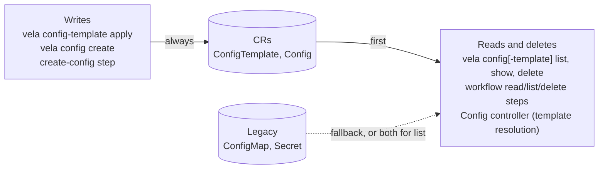

# Design 02: Backward compatibility and the CLI

Companion design note to [KEP-2.18](../README.md). See the [design index](./README.md).

- Owner: Jerrin Francis (@jerrinfrancis)
- Date: 2026-11-16
- Status: Implemented (KubeVela v1.12; #7439, issue #7410)

### Introduction

A cluster upgraded from 1.11 holds config templates as `config-template-<name>` ConfigMaps and
configs as labelled Secrets, written by the 1.11 CLI, VelaUX, addons and workflow steps. After the
upgrade nothing about those objects changes: they keep working, and the new CLI and controller see
them. This note describes the rule that makes that true, and what each CLI command does with each
storage. Moving the objects into CRs is [Design 03](./03-migration.md).

### The rule: one write path, two read paths

- **Every read looks at both storages, always.** The Config controller resolves a template CR
  first and falls back to the legacy ConfigMap; the CLI and the workflow steps list, show and delete
  across both. No feature gate turns this on or off.
- **Every new write is a CR.** `vela config-template apply` writes a `ConfigTemplate`,
  `vela config create` writes a `Config`, the `create-config` step writes a `Config`
  ([Design 07](./07-workflow-steps.md)). There is no flag to write legacy objects.
- **Legacy objects are never deleted by an upgrade or a migration.** Only an explicit
  `vela config[-template] delete` removes one.

An output Secret a Config writes keeps the labels 1.11 readers look for
(`config.oam.dev/catalog: velacore-config`, `config.oam.dev/type`), so a consumer that reads config
Secrets directly, an Application or an older CLI, sees a CR-backed config as before.

### CLI commands

| Command | Behaviour |
|---|---|
| `vela config-template apply -f` | Writes a `ConfigTemplate` CR, created or updated. Fails without the CRD (`the ConfigTemplate CRD is not installed; upgrade vela-core before applying config templates`). Refuses, before writing, a `system` template outside `vela-system` and turning `sensitive` off. Prints a note when the CR now shadows a legacy ConfigMap of the same name, pointing at `vela config-template migrate` |
| `vela config-template show` | The template's parameters, from the CR, or the legacy ConfigMap when there is no CR |
| `vela config-template delete` | Deletes the CR if there is one, otherwise the legacy ConfigMap. When it deleted the CR and a legacy ConfigMap of the name remains, it says so: that ConfigMap is in effect again |
| `vela config-template list` | Both storages, CR rows then legacy rows, with a `SOURCE` column (below). Templates the controller generates for `SourceDefinition` caches are not listed |
| `vela config-template migrate` | [Design 03](./03-migration.md) |
| `vela config create` | Validates the properties against the template from either storage, then writes a `Config` CR. Fails without the CRD. For a sensitive template the properties go to a `<name>-properties` Secret referenced by `spec.propertiesFrom`. `--target` creates the distribution Application, owned by the Config. `--dry-run` prints the rendered Secret and `outputs` and writes nothing |
| `vela config list` | Both storages, with `SOURCE` and `PHASE` columns; legacy rows have no phase, since nothing reconciles them |
| `vela config delete` | A `Config` CR of the name is deleted (its Secret, `outputs` and distribution follow by garbage collection; the `<name>-properties` Secret is removed explicitly). Otherwise the legacy Secret and the objects its `objects-reference` lists are deleted, and its distribution recalled |
| `vela config distribute` | Unchanged; the distribution Application is owned by the Config when one exists |
| `vela config migrate` | [Design 03](./03-migration.md) |

**`SOURCE` values** in `vela config-template list`:

| Value | Meaning |
|---|---|
| `crd` | a `ConfigTemplate` CR |
| `legacy` | a legacy ConfigMap with no CR of its name |
| `legacy (shadowed)` | a legacy ConfigMap with a CR of the same name and namespace that migration did not create: the CR is in effect |
| `legacy (migrated)` | only with `--config-mode legacy`: a ConfigMap migration adopted. In the merged view the CR row stands for it and the ConfigMap is not repeated |

**`--config-mode`** exists only on the two `list` commands: `legacy` or `crd` shows one storage;
the default shows both. The first CRD implementation (#7211) had it as a root flag on every
command, with an `auto` value; it never shipped in a release, and every other command now rejects it
as an unknown flag.

**CRD probes.** The two CRDs could be installed apart from each other, so each writing command
checks that the API server serves the kind it writes (`kindServed`) and fails with an upgrade
message if not. Readers treat a kind that is not served as an empty list and carry on with the
legacy storage, so the new CLI also works against a 1.11 control plane for reads and deletes.

### Old clients and addons

| Client | What still works |
|---|---|
| 1.11 `vela` CLI | Writes legacy objects, which every reader sees and migration can adopt later. Sees CR-backed configs through their output Secrets. Does not see `ConfigTemplate` CRs, so it cannot create a config from a template that exists only as a CR |
| VelaUX | Not changed by this work (out of scope of issue #7410) |
| Addons | Still install config templates as legacy ConfigMaps in `vela-system`; they work as system templates. An addon template that has been migrated is no longer followed by addon upgrades ([Design 09](./09-known-limits.md)) |
| Configs created by an old client after migration | Stay legacy until `migrate` runs again or the controller restarts with the gate on; the startup sweep has no watch ([Design 03](./03-migration.md)) |

### Alternatives not taken

- **Two feature gates** (`LegacyConfigCompatibility` and `AutoMigrateLegacyConfigs`) with a
  four-way matrix and a ConfigMap telling the CLI the gate state. Rejected: compatibility is
  unconditional, so only migration needs a switch.
- **`--config-mode` on every command, with `auto`.** Rejected: two write paths double what has to
  stay compatible, and a write to legacy storage from a new CLI has no reader that needs it.
- **A legacy fallback in `apply` and `create` when the CRD is missing.** Rejected: a new CLI
  against an old control plane fails clearly instead of writing objects the user did not ask for.
