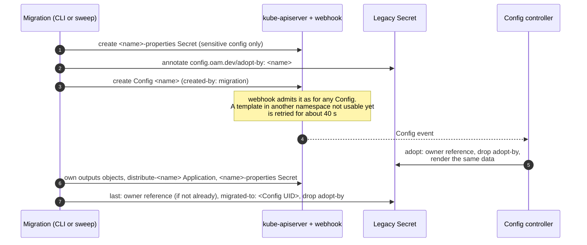
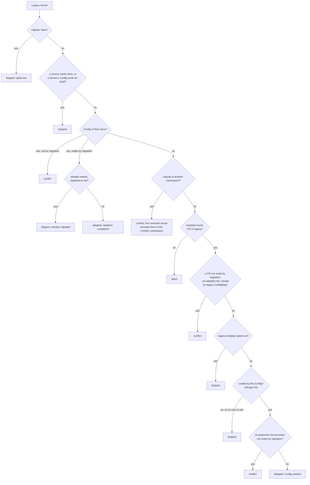
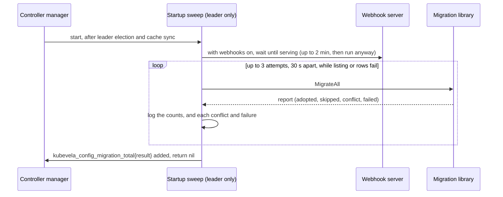

# Design 03: Migration

Companion design note to [KEP-2.18](../README.md). See the [design index](./README.md).

- Owner: Jerrin Francis (@jerrinfrancis)
- Date: 2026-11-16
- Status: Implemented (KubeVela v1.12; #7449, #7453, #7518, issue #7410)

### Introduction

[Design 02](./02-backward-compatibility-and-cli.md) keeps legacy objects working. This note turns
them into CRs: a legacy template ConfigMap becomes a `ConfigTemplate`, a legacy config Secret
becomes a `Config` that **adopts the Secret in place**. One library in `pkg/config/migrate.go` does
the work; three entry points drive it:

| Entry point | Covers |
|---|---|
| `vela config-template migrate <name> [-n ns]` | one legacy template and every legacy config made from it, in any namespace |
| `vela config-template migrate --all [-n ns]` | every legacy template in the namespace with its configs, then every legacy config left in the namespace |
| `vela config migrate <name> [-n ns]` / `--all` | one legacy config, or every one in the namespace; their templates may be CRs or still legacy |
| The `AutoMigrateLegacyConfigs` startup sweep | everything legacy in the cluster, once per controller start |

All take `--dry-run` (the commands) and report one row per legacy object.

### Principles

- **Nothing is deleted, nothing is re-encoded.** The legacy ConfigMap stays, annotated with the CR
  that replaced it. The legacy Secret stays the same object (same name, UID and data), now owned by
  its Config, so Applications that read it see no churn. Rolling back to 1.11 finds every legacy
  object where it was ([Design 08](./08-gitops-upgrade-and-rollback.md)).
- **Nothing a Config can observe changes.** The CR gets the scope its legacy object always had in
  effect (below), and the controller's first render produces the Secret that was there.
- **Idempotent.** A second run changes nothing: what was adopted reports `skipped`, and a conflict
  stays a conflict until it is resolved. A run interrupted half-way is finished by the next one.
- **Opt-out per object.** `config.oam.dev/migrate: "false"` on a legacy ConfigMap or Secret keeps it
  legacy; on a template ConfigMap it keeps that template's configs legacy too.

### Mapping

**Template.** `config-template-<name>` in namespace N becomes `ConfigTemplate <name>` in N, labelled
`config.oam.dev/created-by: migration`. `template`, `sensitive`, `alias` and `description` carry
over. The **scope comes from the namespace, not the label**: `system` in `vela-system`, `namespace`
elsewhere, which is how the resolver has always treated the ConfigMap; the 1.11 `scope` label
(`system`, `project`, `global`, `env`) never restricted anything. Configs in other namespaces bound to
a namespace-scoped template are recorded in its `config.oam.dev/grandfathered-configs` annotation,
so they keep working ([Design 04](./04-template-scope-and-access.md)). The ConfigMap gets
`config.oam.dev/migrated-to: <ConfigTemplate UID>`.

**Config.** A Secret labelled `config.oam.dev/catalog: velacore-config` becomes a `Config` of the
same name and namespace, labelled `config.oam.dev/created-by: migration`:

| From the legacy Secret | To the Config |
|---|---|
| label `config.oam.dev/type`, annotation `config.oam.dev/template-namespace` (empty: `vela-system`) | `spec.templateRef` |
| `input-properties`, config not sensitive | `spec.properties` |
| `input-properties`, config sensitive (the template's flag, or the Secret's own `config.oam.dev/sensitive: "true"`) | a new `<name>-properties` Secret, referenced by `spec.propertiesFrom` |
| alias, description | `spec.alias`, `spec.description` |
| annotation `config.oam.dev/nacos-endpoint` | the same annotation on the Config ([Design 05](./05-sensitive-data.md)) |

The Config then becomes the controller owner of the legacy Secret, of the `outputs` objects the
Secret's `objects-reference` lists, of the `distribute-<name>` Application, and of the
`<name>-properties` Secret. The legacy Secret gets `config.oam.dev/migrated-to: <Config UID>`. The
labels an Application put on a Secret its `create-config` step wrote are removed, so that
Application's garbage collection no longer deletes it.

### Adoption in place

The Config controller refuses a Secret it does not control ([Design 01](./01-config-crd-management.md)).
Migration creates the Config first and sets the owner reference after (it needs the Config's UID),
so for a moment the controller would find the Secret unowned. The hand-over closes that gap:

The controller accepts the hand-over only when the Secret's `adopt-by` names this Config, the
Config carries the migration label, and the Secret has no other controller. Writing `adopt-by`
takes write access to the Secret, which a Config author alone does not have, so a hand-made Config
cannot claim someone else's Secret by naming itself after it. If creating the Config fails, the mark
is removed again.

### Outcomes

Every legacy object the run looks at is one row, `KIND NAME NAMESPACE RESULT REASON`, followed by
`adopted N, skipped N, conflict N, failed N`. A conflict or a failure makes the command exit
non-zero; the run carries on past them. `--dry-run` prints the CRs it would create, reports
`would adopt`, and writes nothing.

Templates follow the same pattern: opted out (`skipped`), a CR of the name not made by migration
(`conflict`), a `nacos` block naming an endpoint in a third namespace that migration cannot review
for anyone (`skipped`, apply it as a user who may), otherwise `adopted`.

A user who cannot list Secrets cluster-wide gets the namespace they can see migrated and one
`skipped` row for the rest (`*` in the name column), with exit code 0: a namespace-scoped user is
not wrong to be one.

**Events** are recorded on the legacy objects: `MigrationAdopted`, `MigrationSkipped`,
`MigrationConflict`, `MigrationFailed` (source `vela-cli` for the commands, `ConfigMigration` for
the sweep); a row skipped as already migrated records none. An adopted object that a GitOps or release tool manages (Argo CD's tracking annotation,
Flux's labels, Helm's `managed-by`, or `app.kubernetes.io/instance` alone) also gets a `MigratedGitOpsManaged` Event on the new CR and a
note in its row: keep the CR in git where the legacy object was
([Design 08](./08-gitops-upgrade-and-rollback.md)). Every write uses the field manager
`kubevela-config-migration`, so a tool that applies the legacy object server-side does not see
migration's additions as drift in its own fields.

### The startup sweep (`AutoMigrateLegacyConfigs`)

`pkg/controller/config.oam.dev/v1alpha1/migration/`. With the gate on (Alpha, default off; Helm
value `featureGates.autoMigrateLegacyConfigs`), the controller adds a runnable that runs
`MigrateAll` once per start:

- It never fails the manager: list errors and panics are logged, and readiness does not wait for it.
- With webhooks on, it waits for the webhook server because every Config it creates goes through that server, which
  runs in the same process.
- A restart runs it again; everything already adopted comes back `skipped`.
- It does not watch for legacy objects created later (by an older CLI, say): run `migrate` again or
  restart the controller.
- It runs with no user. A config bound across namespaces to a namespace-scoped template is adopted
  only when the template's CR grandfathers it ([Design 04](./04-template-scope-and-access.md)).
- With sharding, only the master shard runs it; worker shards run only the Application controller.

### Alternatives not taken

- **A Config that references the legacy Secret through `propertiesFrom`**, as the KEP proposed.
  Rejected: it leaves two Secrets per config, and the one Applications read would be a new object
  with a new UID.
- **Deleting legacy objects after adoption** (`migrate --delete-source`). Not done: keeping them is
  what makes a rollback to 1.11 work, and nothing reads them once a CR shadows them.
- **Event-driven adoption** of legacy objects created after the sweep. Deferred: a watch on every
  Secret in the cluster for a transition case the commands already cover.
- **Leaving outputs in another namespace unowned.** Rejected for `conflict`: the controller applies
  `outputs` in the Config's namespace, so it would create a second copy and orphan the first.
