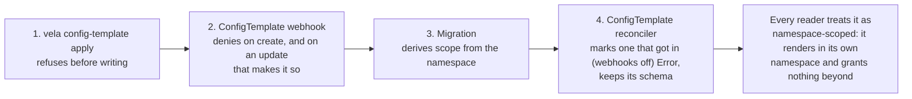
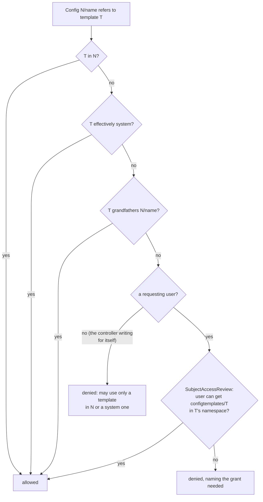

# Design 04: Template scope and access

Companion design note to [KEP-2.18](../README.md). See the [design index](./README.md).

- Owner: Jerrin Francis (@jerrinfrancis)
- Date: 2026-11-16
- Status: Implemented (KubeVela v1.12; #7481, issue #7410)

### Introduction

A `ConfigTemplate` is namespaced, and a `Config` names its template by `{name, namespace}`. Without
rules, any template could live anywhere and any Config could use any template; and since the Config
controller reads templates with its own permissions, anyone able to create a Config could render
any template in the cluster. This note describes the two rules that close that: where a `system`
template may live, and which Configs may use which templates.

### Scope

| `spec.scope` | Lives in | Usable from |
|---|---|---|
| `system` | `vela-system` only | any namespace |
| `namespace` (default) | any namespace | its own namespace; another namespace only with access (below) |

The **effective scope** every reader applies (`ResolvedTemplate.EffectiveScope` in
`pkg/config/resolve.go`):

- a `ConfigTemplate` is `system` only if it is in `vela-system` **and** declares `scope: system`;
  anything else reads as `namespace`, whatever it declares;
- a legacy `config-template-<name>` ConfigMap is `system` in `vela-system` and `namespace`
  elsewhere, by its namespace alone. Its 1.11 `config.oam.dev/scope` label (`system`, `project`,
  `global`, `env`) never restricted anything and is not read. Migration writes the same scope onto
  the CR it creates ([Design 03](./03-migration.md)), so adoption changes nothing a Config sees.

### The placement guarantee

A `system` template outside `vela-system` must be impossible to create, and harmless if it gets in
anyway. Four layers; the CLI and the webhook refuse and the reconciler reports `Error`, all with the
same message (`scope system is only valid in vela-system`):

A template already misplaced may still be edited or fixed: the webhook denies only the update that
newly misplaces it.

### Who may use a template

`AccessToTemplate` in `pkg/config/resolve.go` answers "may a Config in namespace N use this
template":

| Template | A Config in N may use it |
|---|---|
| in N | always |
| effective scope `system` | always |
| `namespace` scope in another namespace | only if the **requesting user** can `get` that `ConfigTemplate` (a SubjectAccessReview), or the template's `config.oam.dev/grandfathered-configs` lists the Config as `N/name` |

The review asks about `get` on the `ConfigTemplate`, whichever storage holds the template today, so
the grant an operator gives keeps working when a legacy template is migrated.

**Where it is checked.** The Config webhook, on create only: `spec.templateRef` is immutable
([Design 01](./01-config-crd-management.md)), so the answer holds for the Config's lifetime. A
reference to a template that does not exist or is not usable yet is denied at create unless the
template is in the Config's namespace or is a `ConfigTemplate` in `vela-system` declaring
`scope: system`, because the access question can only be asked once the template's scope is known. The Config controller does not repeat the
SubjectAccessReview: it has no requesting user. A Config admitted with the webhooks off is the
operator's decision, as with every other admission rule. Migration asks the same table for the
user who runs it ([Design 03](./03-migration.md)).

**The workflow step.** `create-config` checks the same table before it reads the template
([Design 07](./07-workflow-steps.md)):

- with the `AuthenticateApplication` feature gate on, the review is asked for the Application's
  identity: its user (`app.oam.dev/username`, written with `--authentication-with-user`), else its
  service account, else the default user;
- with it off, there is no user: the step may use only a template in the Application's namespace or
  a `system` one. The Config webhook gives the controller's own writes the same structural answer,
  taking the namespace from the Config's `app.oam.dev/namespace` label, so a step cannot widen it by
  setting another namespace on the Config.

**Grandfathered bindings.** In 1.11 nothing restricted which namespace a config's template lived in.
When migration adopts a namespace-scoped template, it records every legacy config in another
namespace bound to it in `config.oam.dev/grandfathered-configs` on the new `ConfigTemplate`, and
those Configs need no review. The webhook lets that list shrink but never grow, so updating a
template cannot exempt a new Config from the review.

### The Nacos endpoint rule

A template's `nacos` block names an endpoint config (a Secret) that the controller reads with its own
permissions to publish ([Design 06](./06-nacos-expanded-writer.md)). The same reasoning applies:

| Endpoint in | Allowed |
|---|---|
| the template's namespace, or `vela-system` (the shared endpoints) | always |
| any other namespace | only if the user applying the template can `get` that Secret; checked by the ConfigTemplate webhook on create and on an update that changes `spec.template` |

The controller checks what each Config actually renders: an endpoint outside the free namespaces
must be the literal one the template's text names, which admission reviewed. A legacy template was
never reviewed, so a Config rendered from one may use only an endpoint in a free namespace;
migration skips a legacy template that names an endpoint anywhere else.

### Not changed

- **Chart RBAC.** The controller keeps its permissions; access is decided per requesting user at
  admission. The chart's `template-reader` Role and binding are not used by these rules.
- **The webhooks are the enforcement point.** With them off, the structural rules hold (placement,
  effective scope) and the user rules do not.

### Alternatives not taken

- **Cluster-scoped `ConfigTemplate`**, as the KEP proposes. Not done: the API shipped namespaced in
  #7211, and namespace-scoped templates let a team own templates without cluster-wide rights.
- **Requiring Configs from a `system` template to live in `vela-system`.** Rejected: system templates
  exist to be used from every namespace, as addon templates always were.
- **Scope from the legacy label** (`global` to `system`, the rest to `namespace`). Rejected for scope
  by namespace: the label was never enforced, and a legacy template in `vela-system` has always been
  usable everywhere.
- **Reviewing every update of a Config.** Not needed: the reference is immutable, so the create is
  the only time the answer can change.
