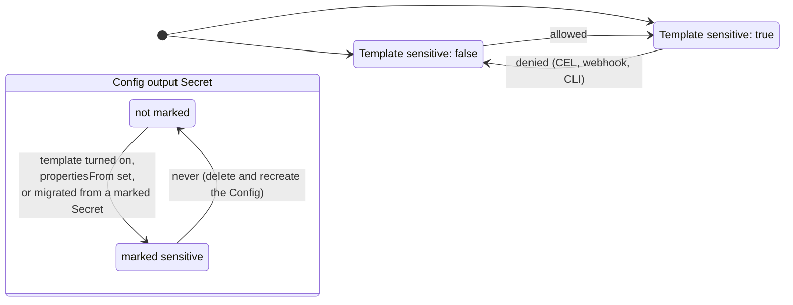

# Design 05: Sensitive data

Companion design note to [KEP-2.18](../README.md). See the [design index](./README.md).

- Owner: Jerrin Francis (@jerrinfrancis)
- Date: 2026-11-16
- Status: Implemented (KubeVela v1.12; #7501, #7515, issue #7410)

### Introduction

A config often holds credentials: a registry password, a database user, a Nacos login. 1.11 had one
flag for them, `sensitive` on the template, which kept the config's input properties out of the
read paths (`vela config`, the `read-config` step). With CRs that flag alone left gaps: a Config
could source its properties from a Secret while its template said it was not sensitive, so the
credentials landed in `input-properties` marked readable; and the flag could be switched off on a
live template, handing back what had been withheld. This note describes the rules that close those
gaps and where each is enforced.

### What "sensitive" means

A config is sensitive when its output Secret carries `config.oam.dev/sensitive: "true"`. Then:

- the read paths never return its input properties (below);
- a sensitive template refuses inline `spec.properties`: the values belong in a Secret, referenced by
  `spec.propertiesFrom`, so they are never stored in the Config object.

A config is sensitive when **any** of these is true:

| Source | Why |
|---|---|
| its template has `spec.sensitive: true` (a legacy ConfigMap: `config.oam.dev/sensitive: "true"`) | the template author says so |
| its Config uses `spec.propertiesFrom` | properties kept in a Secret are treated as secret, whatever the template says |
| its Secret was already marked sensitive | a mark is never removed (below) |

### The rules

| Rule | Enforced by |
|---|---|
| A template's `sensitive` can be turned on, never off | the CRD's CEL transition rule (Kubernetes 1.25+, answers before the webhook); the ConfigTemplate webhook (any version); `vela config-template apply` before it writes; the factory keeps a stored `true` when a tool rewrites a template |
| A sensitive template refuses inline `spec.properties` | the Config webhook (create and update); the Config controller (`Error`: `is sensitive: spec.properties must not be set, use spec.propertiesFrom instead`) |
| `propertiesFrom` always makes the Config sensitive | the Config controller marks the Secret before anything else in the reconcile can fail, the template's resolution included |
| A Secret marked sensitive stays marked | the Config controller never writes the mark back to `false`; only deleting and recreating the Config resets it |
| The CLI never writes sensitive values inline | `vela config create` puts a sensitive template's properties in a `<name>-properties` Secret referenced by `propertiesFrom` |
| Migration never moves sensitive values inline | a legacy config whose template or Secret is sensitive becomes a Config with a `<name>-properties` Secret ([Design 03](./03-migration.md)) |

**Turning `sensitive` on** for a template in use is allowed. The Config controller watches the
template, so every dependent Config is reconciled at once: its Secret is marked sensitive before
anything else is checked, and a Config with inline properties goes to `Error` until its author moves
the values to `propertiesFrom`. Readers stop returning the values immediately, even while the Config
is in `Error`.

**Why the marks are sticky.** Turning sensitive off can still happen where no admission runs: a
legacy ConfigMap's annotation edited by hand, or a template edited with the webhooks off on a server
older than 1.25 (which drops the CEL rule). What was withheld from readers is not handed back in
those cases either, because the Secret keeps its mark.

### Who reads a sensitive config's properties

| Reader | Sensitive config |
|---|---|
| `read-config` workflow step, the factory's `ReadConfig` and `GetConfig` | refused (`the config is sensitive`) |
| `list-config` workflow step, `vela config list` | listed, without properties or Secret data |
| The Config controller rendering the Config | reads them: it needs them to render |
| The Config controller reading a **Nacos endpoint** config | reads it only if the endpoint config carries `config.oam.dev/nacos-endpoint: "true"`; otherwise `NacosSynced` is `False`, reason `EndpointUnreadable` |
| The application controller's `SourceDefinition` cache | reads only its own cache entries (`pkg/config.SecretInputProperties` after `IsSourceCacheEntry`); a planted Secret of the same name is not an entry and is not read |

**The `nacos-endpoint` mark** is the owner's leave for one specific use. An endpoint config holds the
Nacos login, so it is usually sensitive; the controller needs to read it to publish. The owner sets
`config.oam.dev/nacos-endpoint: "true"` on the `Config` (or, for a legacy config, on its Secret).
The controller copies the mark from the Config to the Secret it owns and removes it when the Config
loses it; a hand edit of the Secret or a template's `output` cannot grant it. A non-sensitive
endpoint config needs no mark.

### Alternatives not taken

- **Per-parameter `// +sensitive` markers** with the CLI splitting values between inline properties
  and a Secret, as the KEP proposes. Not done: the API shipped with a template-level flag and a
  single `propertiesFrom` Secret, and the rules above close the gaps without a second sensitivity
  model.
- **Letting `sensitive` go back to `false`.** Rejected: once a reader has been refused, handing the
  values back is a disclosure nobody approved.
- **Refusing sensitive endpoint configs outright**, as #7457 first did. Reversed in #7501 and
  narrowed in #7515: a Nacos login is the common case, so the owner marks the config for this use.
