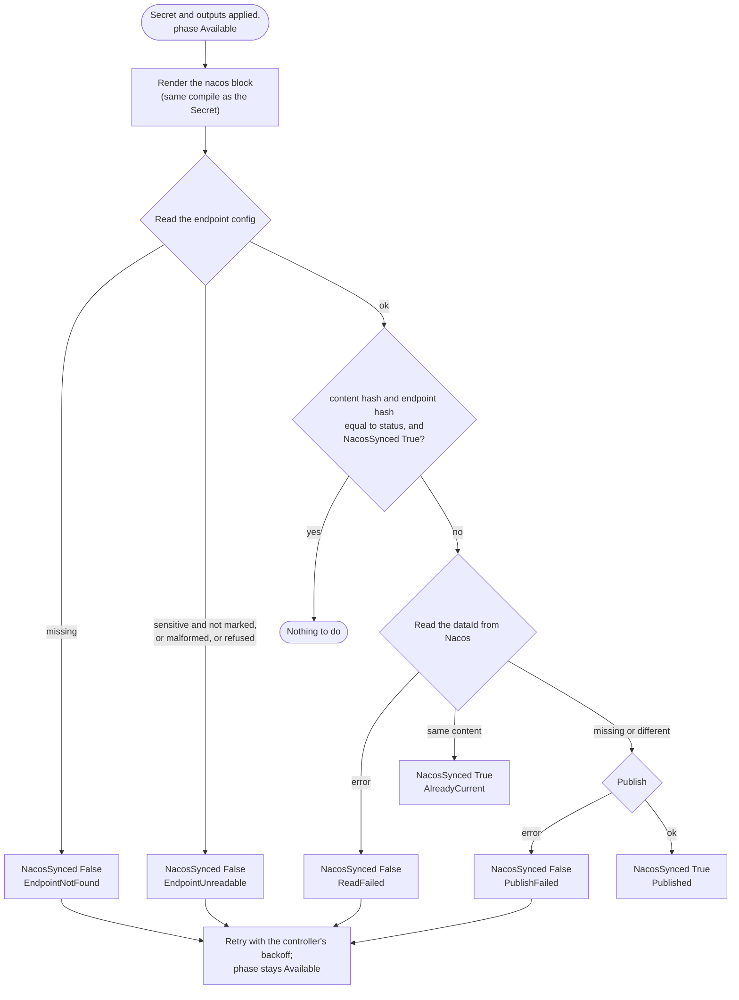

# Design 06: The Nacos expanded writer

Companion design note to [KEP-2.18](../README.md). See the [design index](./README.md).

- Owner: Jerrin Francis (@jerrinfrancis)
- Date: 2026-11-16
- Status: Implemented (KubeVela v1.12; #7457, #7467, #7515, issue #7410)

### Introduction

A config template may carry a `nacos` block next to its `output`: besides the Secret, the config's
content is published to a Nacos configuration server. In 1.11 this "expanded writer" ran only inside
`Factory.CreateOrUpdateConfig`, on the machine of whoever ran `vela config create`. A Config applied
with `kubectl` or by a GitOps tool reached `Available` and published nothing. This note describes the
publish as part of the Config controller.

### The template block

```cue
template: {
    nacos: {
        endpoint: {                   // literals only: a Config cannot move the endpoint
            name:      "nacos"        // the endpoint config: a config made from the nacos-server template
            namespace: "vela-system"  // optional; vela-system by default
        }
        format: "json"                // json, yaml, toml or properties
        metadata: {
            dataId: parameter.dataId
            group:  parameter.group
        }
        content: parameter.content
    }
    parameter: { ... }
}
```

The ConfigTemplate webhook checks the block's shape on create and update (`endpoint.name`,
`metadata.dataId`, `format`), and an endpoint in a namespace other than the template's own or
`vela-system` against the requesting user's right to read it
([Design 04](./04-template-scope-and-access.md)). The Config controller repeats the shape check for
a template that reached the cluster with the webhooks off; a broken block puts the Config in `Error`.

### The sync

After the output Secret and `outputs` are in place, the controller syncs Nacos
(`pkg/controller/config.oam.dev/v1alpha1/config/nacos_sync.go`):



- **Publish only on change.** The status records a hash of the rendered content and a hash of the
  endpoint's server part (addresses, ports, region; never the credentials). Equal hashes and a
  `True` condition mean nothing is sent. Rotated credentials change nothing in Nacos and do not
  trigger a publish.
- **Read before publishing.** Content Nacos already holds is never published again, which keeps
  Nacos's history clean: a config the 1.11 CLI published before the upgrade comes up as
  `AlreadyCurrent`, and so does a reconcile that runs on a cache older than the controller's own last
  status write.
- **A refused publish is a failure.** A publish Nacos answers with a refusal is `PublishFailed`, not
  `Published`.
- **Nacos never decides the phase.** The Secret and `outputs` are in place, so the Config is
  `Available`; Nacos trouble is on the `NacosSynced` condition and retried with backoff. No Nacos
  error is terminal.
- **Nothing is ever deleted from Nacos.** Deleting a Config, or removing the block from its template,
  leaves the published entry; `status.expandedWriter` and the condition are cleared in the latter case.

`status.expandedWriter.nacos` holds `dataId`, `group`, `contentHash`, `endpoint`, `endpointHash` and
`lastSyncTime`, the last confirmed sync. The `endpoint` reference is written on every attempt,
successful or not.

### The endpoint config

The block names a config, usually made from the `nacos-server` template, that holds the server
address and login. The controller reads it from either storage: a legacy config Secret or the output
Secret of a `Config`, both under the key `input-properties`.

| Endpoint config | Used |
|---|---|
| not sensitive | yes |
| sensitive, marked `config.oam.dev/nacos-endpoint: "true"` by its owner | yes ([Design 05](./05-sensitive-data.md)) |
| sensitive, not marked | no: `EndpointUnreadable`, naming the annotation to add |
| in a namespace other than the template's or `vela-system` | only the one the template's text names, which admission reviewed ([Design 04](./04-template-scope-and-access.md)) |

**Watching the endpoint.** Configs are indexed by the endpoint their status names
(`status.expandedWriter.nacos.endpoint`). When that Secret appears, changes or goes, exactly the
Configs that use it are reconciled: `EndpointNotFound` clears as soon as the endpoint exists, a
changed server is re-synced (read first), and a deleted endpoint is reported.

### What the CLI does now

`vela config create` writes the `Config` and returns; it no longer publishes from the user's machine.
It prints that the controller publishes the content and where to look (`NacosSynced` on the Config).
A config the 1.11 CLI published keeps its content; adopting it changes nothing in Nacos.

### Alternatives not taken

- **Keeping the publish in the CLI.** Rejected: a Config applied by any other path would never
  publish, which is the gap this closes.
- **Deleting the Nacos entry with the Config.** Not done: a Nacos entry may be read by systems
  outside the cluster, and 1.11 never deleted one either.
- **A finalizer to clean up Nacos.** Not needed without deletion, and a finalizer would block
  deleting a Config whenever Nacos is unreachable.
- **Pluggable writers.** Out of scope here; the KEP notes it as future work.
