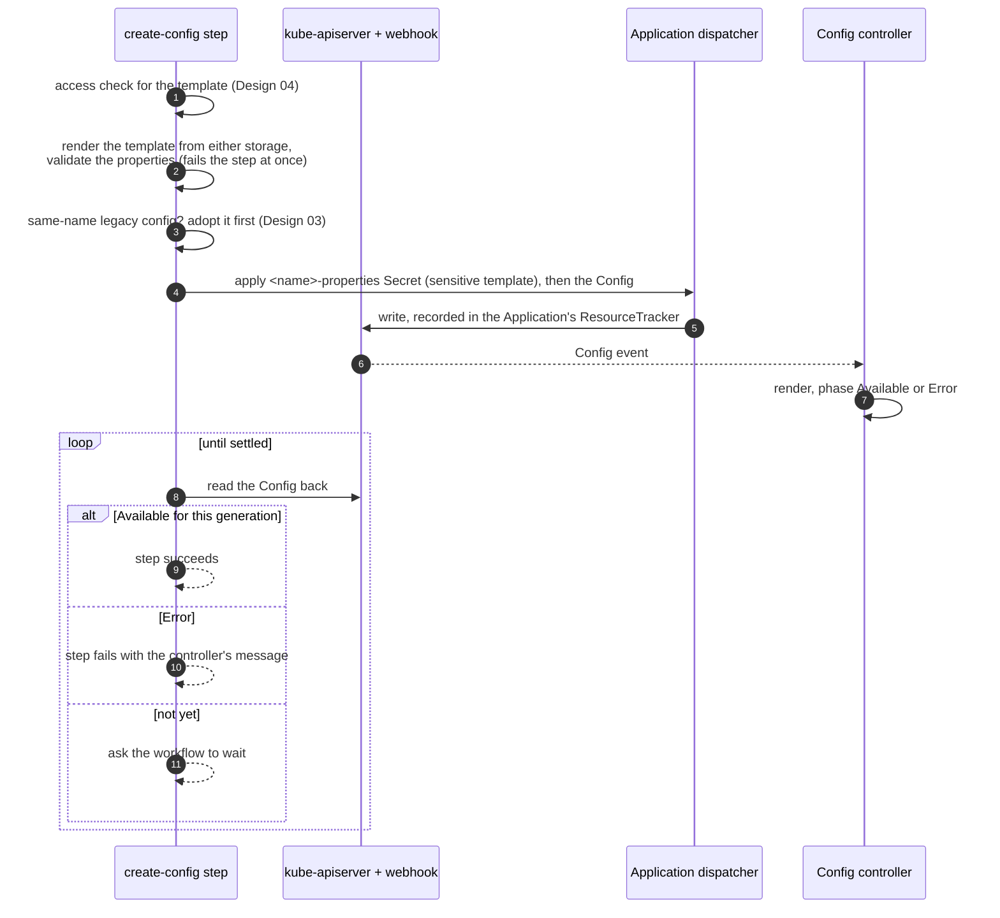

# Design 07: Workflow steps

Companion design note to [KEP-2.18](../README.md). See the [design index](./README.md).

- Owner: Jerrin Francis (@jerrinfrancis)
- Date: 2026-11-16
- Status: Implemented (KubeVela v1.12; #7470, #7481, issue #7410)

### Introduction

Four built-in workflow steps work with configs: `create-config`, `read-config`, `list-config` and
`delete-config`. They run on the `config` provider (`pkg/workflow/providers/config/`, ops
`create`, `read`, `list` and `delete`); the legacy provider exposes the same code as
`create-config`, `read-config`, `list-config` and `delete-config`. In 1.11 `create-config` wrote a legacy Secret from the controller
pod. Now it writes a `Config` CR, so a config an Application creates is validated, reconciled and
published like any other; the other three read both storages.

### `create-config`

- **Through the Application's dispatcher.** The Config, and the `<name>-properties` Secret of a
  sensitive template, are applied by the Application's resource dispatcher and recorded in its
  ResourceTracker. They are garbage-collected with the Application, as the legacy Secret was. The
  properties Secret is applied first, on its own, because the Config webhook reads it.
- **Access before reading.** The template access rule of
  [Design 04](./04-template-scope-and-access.md) is answered before the template is rendered, so a
  user never sees the output of a template they may not use. With the `AuthenticateApplication`
  gate on, the review is for the Application's user; with it off, only a template in the
  Application's namespace or a `system` one. After that, the template is read with the
  controller's identity, as the Config controller reads it to render.
- **Validated before anything is written.** A missing template or a bad property fails the step
  before any write.
- **Legacy config of the same name.** A config Secret no Config owns is this step's own from a run on
  an older controller, or one the CLI wrote. It is adopted through the migration library first
  ([Design 03](./03-migration.md)), then updated as a Config. A legacy Secret another Application
  dispatched is refused (`is a legacy config managed by application ...`): adopting it would hand
  that Application's config to this one.
- **Waiting.** The step ends only when the Config is `Available` for the spec it just applied
  (`status.observedGeneration` equals the generation; a status without the field is taken as
  current), fails on `Error`, and otherwise asks the
  workflow to wait. A later `read-config` in the same workflow finds the Secret as it did when the
  write was synchronous.
- **Without the Config CRD** (a control plane not yet upgraded), the step writes a legacy Secret as
  before; there is no webhook and no access rule on that path.

### `read-config`, `list-config`, `delete-config`

| Step | Behaviour |
|---|---|
| `read-config` | A Config of the name decides first: `Error` fails the step with its message; not yet `Available` for its generation makes the step wait. Then the properties are read from the Secret, whichever storage wrote it. A sensitive config is refused ([Design 05](./05-sensitive-data.md)) |
| `list-config` | Every config of the template in the namespace once, legacy or CR-backed; a sensitive config is listed without its properties |
| `delete-config` | A Config this Application created goes through the Application's delete handler (the ResourceTracker marks it deleted, so it is not re-applied), with its properties Secret. Any other Config, or a legacy Secret, is deleted as `vela config delete` would |

The step's output is read from `output.config` (`read-config`) or `output.configs` (`list-config`).

### Alternatives not taken

- **Writing the Config directly from the step**, outside the dispatcher. Rejected: the Config would
  outlive the Application that created it, unlike the legacy Secret.
- **The controller as the only adopter of legacy configs.** Possible later; today the step adopts
  through the same library the commands use, so there is one adoption path.
- **Not waiting for `Available`.** Rejected: a following step that reads the config would race the
  controller, where the legacy write was synchronous.
