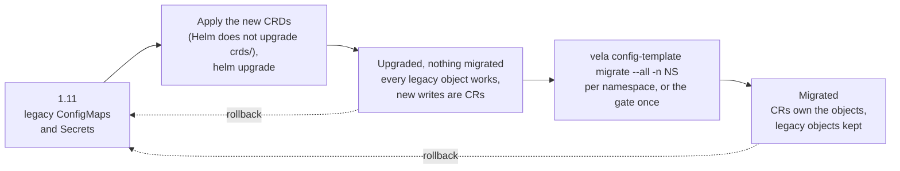

# Design 08: GitOps, upgrade and rollback

Companion design note to [KEP-2.18](../README.md). See the [design index](./README.md).

- Owner: Jerrin Francis (@jerrinfrancis)
- Date: 2026-11-16
- Status: Implemented (KubeVela v1.12; #7518, issue #7410)

### Introduction

One of the KEP's reasons for CRDs is GitOps: a config as a plain manifest that a tool can apply,
compare and prune. This note describes how the CRs behave under a GitOps tool, how legacy objects a
tool manages are migrated, and the upgrade from 1.11 and the rollback to it, with what CI verifies.

### Configs in git

`ConfigTemplate` and `Config` manifests go in git like any other resource. What makes that work:

- **No diff loop.** The controller writes only `status` on the CRs it reconciles; the objects it
  renders (the output Secret, `outputs`) are its own, owned by the Config, not in git.
- **Order mostly does not matter.** A Config applied before or with its template in the same
  namespace is admitted and converges when the template becomes `Available`; so is one that names
  an existing `system` template in `vela-system` not yet reconciled. A Config whose template is in
  another namespace and does not exist or is not yet `Available` is refused until it is: put the template in an earlier
  sync wave, or let the tool's retry apply it ([Design 01](./01-config-crd-management.md)).
- **Sensitive values** go in a Secret the tool manages (or a sealed or external secret), referenced
  by `propertiesFrom`.
- **Pruning cleans up.** Removing a Config from git deletes it; its output Secret, `outputs` and
  distribution Application follow by garbage collection, as with `vela config delete`. Nacos entries
  stay ([Design 06](./06-nacos-expanded-writer.md)).
- **Health.** Flux and Argo CD report a Config in `Error` as healthy today: the CRs have no `Ready`
  condition yet ([Design 09](./09-known-limits.md)). Read `status.phase` and the `Synced`
  condition.

### Legacy objects a tool manages

A legacy template ConfigMap or config Secret kept in git is migrated like any other
([Design 03](./03-migration.md)): owner references and the `migrated-to` annotation, nothing in its
data. Migration writes under its own field manager, `kubevela-config-migration`, so a tool that
applies server-side sees no drift in its own fields. Migration recognises a tool's marker and says so
in the report row and in a `MigratedGitOpsManaged` Event on the new CR:

| Marker | Reported as |
|---|---|
| annotation `argocd.argoproj.io/tracking-id` | Argo CD |
| label `kustomize.toolkit.fluxcd.io/name` or `helm.toolkit.fluxcd.io/name` | Flux |
| label `app.kubernetes.io/managed-by: Helm` | Helm |
| label `app.kubernetes.io/instance` alone | possibly Argo CD (label tracking) or another tool |

The message is the action: put the new CR in git where the legacy object was. Until that is done:

- if git reapplies legacy data that differs from what the controller renders, the two fight over
  the Secret until the CR is committed;
- deleting the migration-created Config garbage-collects the adopted Secret with it.

### Upgrade from 1.11

After the upgrade nothing changes on its own: Applications reading config Secrets see the same
objects (same UID and resourceVersion), the new CLI lists, shows and deletes the legacy objects, and
the controller renders new Configs from legacy templates. Migration is a separate, deliberate step,
per namespace with the command or once for the cluster with `AutoMigrateLegacyConfigs`.

### Rollback to 1.11

Migration never deletes a legacy object, so 1.11 finds every config it had: adopted Secrets are the
same objects, and a config created as a CR after the upgrade has an output Secret with the legacy
labels, which 1.11 reads as a config. The CRDs and CRs stay in the cluster; nothing reconciles them
until the next upgrade.

The chart itself needs one extra step, caused by its move of built-in definitions into
`builtin-definitions` ConfigMaps rather than by the config work: the first `helm rollback` fails,
then delete the `kubevela-vela-core-admission` ValidatingWebhookConfiguration and run
`helm rollback` again. The CI job runs exactly that sequence.

### What CI verifies

| Job | Covers |
|---|---|
| `Config upgrade from 1.11` (`.github/workflows/upgrade-e2e-test.yml`, suite `test/e2e-config-upgrade-test`) | installs 1.11.0 and seeds every kind of legacy object with the 1.11 CLI (plain, sensitive, `outputs`, distributed, Nacos, workflow-created, an addon-shipped template); upgrades to the branch; then: Secrets unchanged and the consuming Application working, both CLIs list, show and delete; `migrate --all` adopts each object once and a second run changes nothing; the gate adopts the rest once and a restart changes nothing; Nacos content kept and a Config edit reaching it; rollback to 1.11.0 with the old CLI and the Application still working |
| `e2e-config-test` GitOps specs (`config_gitops_e2e_test.go`) | server-side apply under Flux's field manager and labels: converges with no diff, a Nacos template syncs, an adopted legacy Secret shows no diff, pruning removes everything |
| `e2e-config-test` Nacos specs (`config_nacos_e2e_test.go`) | a standalone Nacos server: a Config applied with the client alone is published under its `dataId` and `group`, an edit is published again, and a sensitive endpoint is used only once its owner marks it |

The CI job emulates the GitOps tool; the same behaviour was also checked by hand against Flux 2.6.4
and Argo CD 3.1.0.
