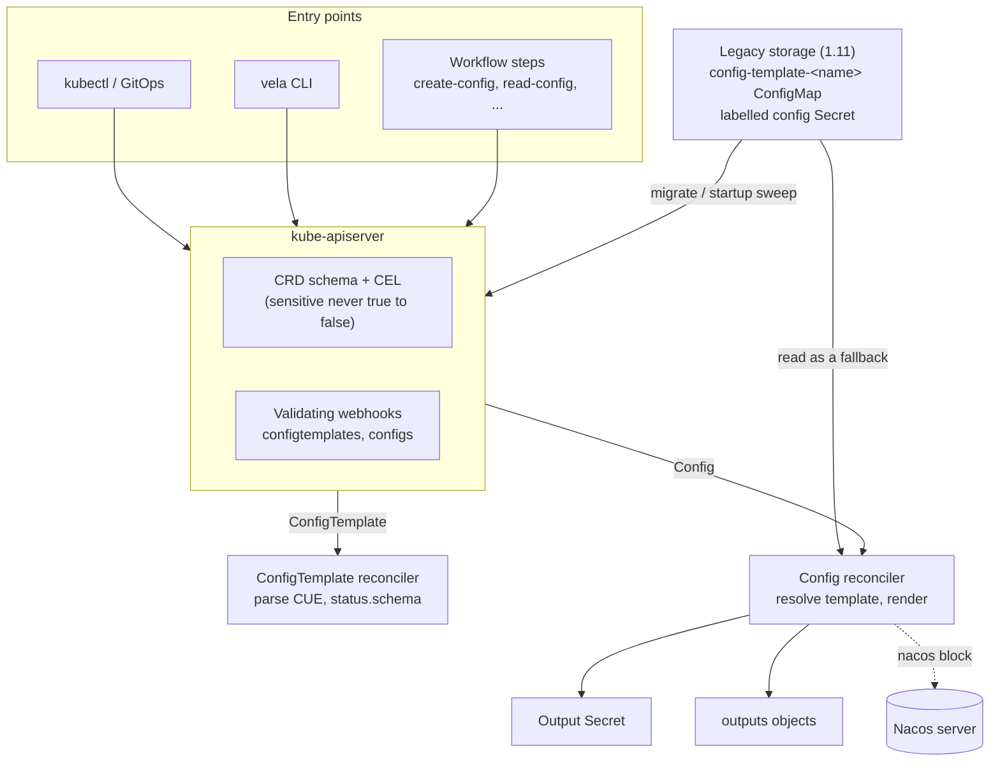

# KEP-2.18 Design Notes (companion design)

- Owner: Jerrin Francis (@jerrinfrancis)

These are companion design notes to [KEP-2.18](../README.md). They describe how `ConfigTemplate`
and `Config` work as `config.oam.dev/v1alpha1` CRDs, as implemented for KubeVela v1.12: the API
(#7211, issue #7105), and backward compatibility with the 1.11 storage and migration to the CRDs
(issue #7410). The KEP remains the vNext direction; where it and these notes differ, these notes
describe what the code does (the KEP's "Implementation status" section lists the differences).
This index is the front door: read it first.

## The picture

A **ConfigTemplate** is a CUE template that describes one kind of config: an image registry, a
database, a Nacos endpoint. A **Config** fills a template with properties. The **Config
controller** renders the template and writes the result: one Secret (the output), optional further
objects (`outputs`), and, when the template has a `nacos` block, a publish to a Nacos server.
Admission webhooks and a CEL rule check what they can before anything is stored.

KubeVela 1.11 kept the same data in a `config-template-<name>` ConfigMap and a labelled Secret per
config. That storage still works: every reader looks at both, every new write goes to a CR, and
legacy objects are adopted into CRs by `vela config-template migrate` or, with the
`AutoMigrateLegacyConfigs` feature gate, once at controller startup.

## Reading order

1. **[Design 01: CRD-based Config Management](./01-config-crd-management.md)**: the API, the two
   reconcilers and the two webhooks. Everything else builds on it.
2. **[Design 02: Backward compatibility and the CLI](./02-backward-compatibility-and-cli.md)**:
   one write path, two read paths; what each `vela config` and `vela config-template` command does
   with each storage.
3. **[Design 03: Migration](./03-migration.md)**: adopting legacy objects into CRs in place, the
   two migrate commands and the `AutoMigrateLegacyConfigs` startup sweep.
4. **[Design 04: Template scope and access](./04-template-scope-and-access.md)**: where a
   `system` template may live, and which Configs may use which templates.
5. **[Design 05: Sensitive data](./05-sensitive-data.md)**: what `sensitive` means, where each rule
   is enforced, and who may read a sensitive config's properties.
6. **[Design 06: The Nacos expanded writer](./06-nacos-expanded-writer.md)**: the controller's
   publish to Nacos.
7. **[Design 07: Workflow steps](./07-workflow-steps.md)**: `create-config`, `read-config`,
   `list-config` and `delete-config` on the CRs.
8. **[Design 08: GitOps, upgrade and rollback](./08-gitops-upgrade-and-rollback.md)**: managing
   the CRs from git, moving from 1.11 and back.
9. **[Design 09: Known limits](./09-known-limits.md)**: what the implementation does not do yet,
   and the alternatives not taken.

## Status of each note

| Note | Status | Implemented in |
|---|---|---|
| 01 CRD-based Config Management | Implemented | #7211, #7457, #7470 |
| 02 Backward compatibility and the CLI | Implemented | #7439 |
| 03 Migration | Implemented | #7449, #7453, #7518 |
| 04 Template scope and access | Implemented | #7481 |
| 05 Sensitive data | Implemented | #7501, #7515 |
| 06 The Nacos expanded writer | Implemented | #7457, #7467, #7515 |
| 07 Workflow steps | Implemented | #7470 |
| 08 GitOps, upgrade and rollback | Implemented | #7518 |
| 09 Known limits | Open | |

## Terms

| Term | Meaning |
|---|---|
| CR | a `ConfigTemplate` or `Config` object of the `config.oam.dev/v1alpha1` API |
| Legacy template | a `config-template-<name>` ConfigMap labelled `config.oam.dev/catalog: velacore-config`, the 1.11 storage of a template |
| Legacy config | a Secret labelled `config.oam.dev/catalog: velacore-config` with no controlling Config, the 1.11 storage of a config |
| Output Secret | the Secret a Config renders; it keeps the legacy config labels, so 1.11 readers still see it |
| Shadowed | a legacy template with a `ConfigTemplate` of the same name and namespace; the CR is the one in effect |
| Adopt | migration's hand-over of a legacy object to a CR in place: same object, now owned by the CR |
| Startup sweep | the one migration of everything legacy that the controller runs at startup when `AutoMigrateLegacyConfigs` is on |
